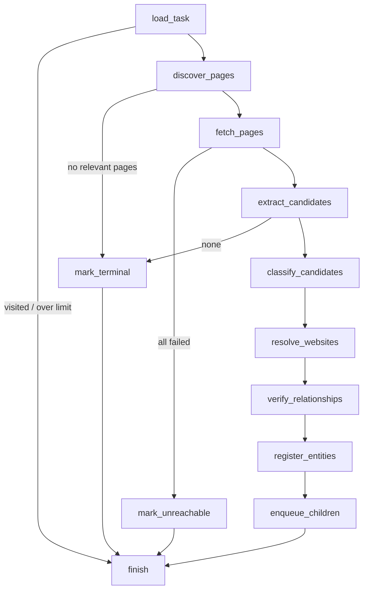
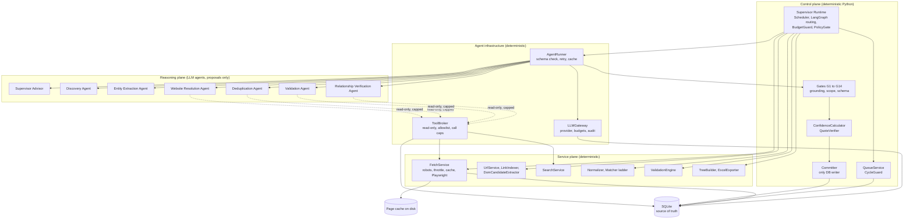
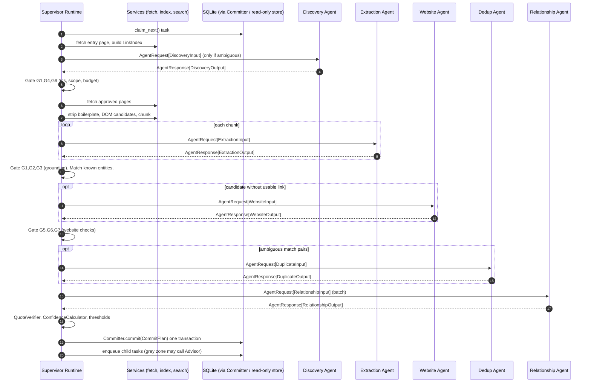
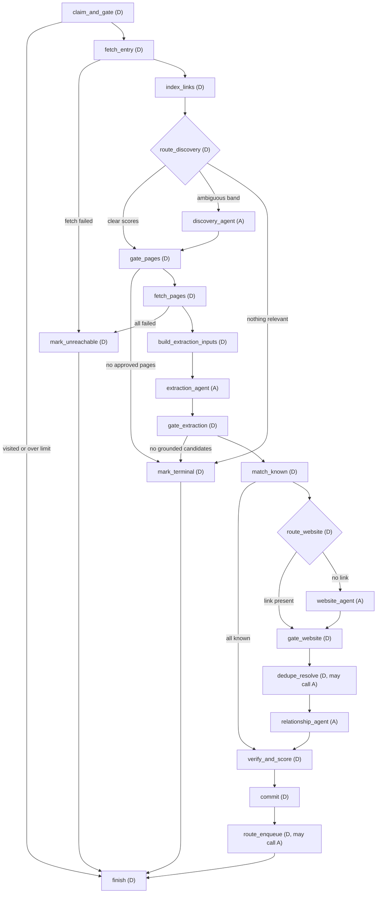
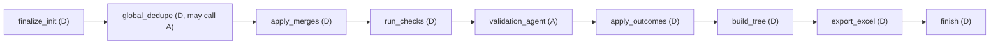

# Architecture: Corporate Hierarchy Discovery Agent

Status: proposal for review. No implementation exists yet.

Structure: Part I (sections 1 to 17) is the base architecture: data model, algorithm, deterministic services. Part II (sections 18 to 29) adds the multi-agent design and supersedes Part I where the two differ (see the table in section 18.2).

Inputs reviewed: `product.md`, `tech.md`, `Corporate-Discovery.md`, `Agent-Workflow.md`, `.kiro/agents/corporate-research-agent.md`, and the project brief (30 sections).

---

## 1. Constraints taken from the steering files

| Source | Constraint |
|---|---|
| `tech.md` | Python 3.12+, Requests + BeautifulSoup + Playwright, LangGraph, Pydantic, SQLite, openpyxl, stdlib `logging`, `.env` config, structured JSON from the LLM. No unnecessary frameworks. |
| `Corporate-Discovery.md` | Nothing hardcoded. No fixed depth. Products, services, solutions, technologies, industries, features, locations are not companies unless evidence proves it. Every company needs name, parent, relationship, website, source URL, evidence, confidence. Unverifiable ownership gets `status = "REVIEW_REQUIRED"`. |
| `Agent-Workflow.md` | 15-step loop: open root, find pages, extract, classify, find website, verify, store, enqueue, visit, recurse, stop, dedupe, validate, export. |
| Agent file | Never invent relationships. Prefer official sources. Evidence on every relationship. Maintain a research queue. Never crawl the same URL twice. Respect robots.txt and rate limits. Flag uncertainty. Do not touch unrelated files. |

Two things to reconcile, with the choice this document makes:

1. Entity types. The steering list (Parent Company, Operating Group, Business Group, Portfolio Company, Subsidiary, Company, Division) is a subset of the brief (adds Portfolio Group, Brand, Business Unit, Acquired Company, Unknown). This design uses the superset. Products, services, solutions, technologies, industries, features and locations are never entity types. They are candidate kinds that get rejected (section 4.3).
2. Two meanings of "status". The brief's Excel column `Status` means operating status (Active / Unknown). The steering `REVIEW_REQUIRED` means verification status. These are separate fields: `operating_status` and `verification_status`.

---

## 2. Design principles

1. The database is the source of truth. The research queue, visited sets, registry and evidence all live in SQLite. The agent state only carries IDs and small working data. This makes runs resumable and keeps the LangGraph state small.
2. The LLM is a structured function, not a free-roaming tool user. Each LLM call has a Pydantic input/output schema, a fixed purpose, and is cached and audited. Crawling, dedupe, cycle checks and limits are deterministic code. This keeps cost, behaviour and audit trail predictable.
3. Nothing is accepted without a verifiable quote. The LLM must return a quote, and code checks that the quote exists in the fetched page text. If not, confidence is capped and the item goes to review.
4. Candidates come from the page, not from the model's memory. A deterministic DOM pass produces candidate strings first. The LLM classifies and judges them. It cannot add names that are not on the page.
5. First-party evidence wins. Third-party sources can raise or lower confidence but can never alone produce a confirmed relationship.
6. Breadth-first with budgets. Shallow levels finish first, so limits cut off the deepest levels and the tree stays coherent.

---

## 3. System overview

```
                 ┌───────────────────────────────────────────┐
  CLI / .env ──► │ Scheduler (plain Python loop)             │
                 │  claims tasks from research_queue (BFS)   │
                 └──────────────┬────────────────────────────┘
                                │ one task = one entity to research
                                ▼
                 ┌───────────────────────────────────────────┐
                 │ Per-entity LangGraph: research_entity     │
                 │  (bounded, ~10 node steps)                │
                 └───────┬───────────────┬───────────────────┘
                         │               │
                 Tools (deterministic)   LLM tasks (structured)
                 fetch, robots, links,   extract, classify, verify,
                 search, quotes,         recurse?, dedupe-resolve
                 registry, queue
                         │               │
                         └──────┬────────┘
                                ▼
                 ┌───────────────────────────────────────────┐
                 │ SQLite: entities, relationships, evidence │
                 │ websites, crawl_pages, research_queue ... │
                 └──────────────┬────────────────────────────┘
                                │ queue empty or limits hit
                                ▼
                 ┌───────────────────────────────────────────┐
                 │ Finalize LangGraph: dedupe → validate →   │
                 │ demote → tree ids/paths → Excel export    │
                 └───────────────────────────────────────────┘
```

### Why two graphs plus a Python loop

A single LangGraph that loops "next entity" would hit LangGraph's recursion limit. Every entity costs around ten node steps, and a hierarchy can have thousands of entities. Raising the limit to a huge number works but hides runaway loops. Instead:

- The scheduler loop in plain Python owns iteration over the persistent queue. It is where MAX_DEPTH, MAX_TOTAL_PAGES, cancellation and resume are enforced.
- `research_entity` is a small graph with a hard recursion limit (about 25). A bug that loops inside one entity fails fast.
- `finalize` is a separate linear graph run once.

LangGraph still provides what we want from it: typed state, conditional routing (skip, terminal, error), and optional checkpointing per task for debugging. Our DB queue, not the LangGraph checkpointer, is the recovery mechanism.

### Module layout (proposed)

```
.
├── ARCHITECTURE.md
├── .env.example
├── main.py                    # CLI entry point
└── src/corpdisc/
    ├── config.py              # Pydantic Settings loaded from .env / CLI
    ├── logging_setup.py
    ├── models/
    │   ├── domain.py          # Entity, Relationship, Evidence, enums
    │   ├── llm_schemas.py     # Pydantic I/O for each LLM task
    │   └── state.py           # ResearchState, FinalizeState
    ├── db/
    │   ├── schema.sql
    │   ├── connection.py      # WAL, foreign keys, single writer
    │   └── repos/             # entities, relationships, queue, pages, evidence
    ├── tools/
    │   ├── urls.py            # canonicalization
    │   ├── robots.py          # robots.txt cache + crawl-delay
    │   ├── fetch.py           # requests → Playwright fallback, throttle, cache
    │   ├── sitemap.py
    │   ├── links.py           # nav/footer/body link extraction + scoring
    │   ├── dom_candidates.py  # deterministic candidate extraction
    │   ├── search.py          # pluggable search provider
    │   └── quotes.py          # quote verification
    ├── llm/
    │   ├── client.py          # provider abstraction, retries, cache, audit
    │   ├── tasks.py           # one function per LLM task
    │   └── prompts/
    ├── registry/
    │   ├── normalize.py
    │   ├── matcher.py         # dedupe ladder
    │   └── confidence.py      # scoring
    ├── agent/
    │   ├── scheduler.py
    │   ├── research_graph.py
    │   ├── finalize_graph.py
    │   └── nodes/
    ├── validation/checks.py
    └── export/excel.py
```

---

## 4. The research algorithm

### 4.1 Task model

A task is "research this entity": `(entity_id, start_url, depth, parent_entity_id)`. The root is seeded from `START_URL` and `ROOT_COMPANY`. Everything else arrives through the queue.

Queue ordering is `(depth, discovery_seq)`, which gives breadth-first order with stable tie-breaks. `UNIQUE(entity_id)` on the queue enforces `visited_entities`.

### 4.2 `research_entity` graph



| Node | What it does | Deterministic / LLM |
|---|---|---|
| `load_task` | Hydrate the task from DB. Check depth, per-domain and total page budgets, and that the entity is not already EXPANDED. Load the ancestry list for cycle checks. | Deterministic |
| `discover_pages` | Fetch the entry URL. Collect nav, footer, sitemap and body links. Score each link by anchor text, URL path tokens, page title and keyword lists. Select the top K within budget. Optionally ask the LLM to re-rank ambiguous links. | Hybrid |
| `fetch_pages` | Fetch selected pages, following pagination links of the same page type. Store text and metadata in `crawl_pages`. | Deterministic |
| `extract_candidates` | DOM pass (cards, lists, tables, logo grids with alt text, anchor lists, JSON-LD `Organization`, footer patterns like "a X company"). Then LLM reads the page text plus the DOM candidates and returns candidates with quotes and the page's ownership context. | Hybrid |
| `classify_candidates` | For each candidate: kind (company, group, brand, product, service, industry, solution, technology, feature, location, other), proposed entity type, and whether it is a corporate entity. Non-entities are stored as rejected candidates. | LLM |
| `resolve_websites` | Use the link found on the page if there is one. Otherwise search in this order: parent site, official site, acquisition announcement, corporate documents, reliable external sources. Disambiguate by parent, country, industry and description. | Hybrid |
| `verify_relationships` | Verify quote presence, derive relationship type, compute confidence (section 7). Decide `CONFIRMED` or `REVIEW_REQUIRED`. | Hybrid |
| `register_entities` | Run the dedupe ladder (section 6), upsert entity, add relationship with cycle check, store evidence and aliases. | Deterministic (LLM only for ambiguous matches) |
| `enqueue_children` | Enqueue new entities that have a website, are `CONFIRMED`, and are within depth and budget. | Deterministic |

### 4.3 Deciding when to stop (requirement 13C)

The recursion question "does this site have more entities?" cannot be answered before looking. So the decision is in two parts:

1. Probe. Every confirmed entity with a website gets a cheap probe: homepage plus navigation (1 to 3 fetches, counted against budgets).
2. Terminal test. If `discover_pages` finds no page that scores above the relevance threshold, or `extract_candidates` yields no accepted child, the entity is marked `TERMINAL`. The LLM `RecursionDecision` task is only called when link scores are ambiguous.

Entity `crawl_state` values:

| State | Meaning |
|---|---|
| `PENDING` | Queued |
| `EXPANDED` | Children were found |
| `TERMINAL` | Probed, nothing further |
| `NO_WEBSITE` | Could not resolve an official site |
| `UNREACHABLE` | Site failed (HTTP, SSL, timeout, robots) |
| `BUDGET_STOPPED` | Depth or page limit |
| `SKIPPED` | Already visited via another path |

### 4.4 Scope guards (avoiding false ownership)

Websites mention partners, customers and vendors. Only ownership-language pages count.

- Page types such as Partners, Customers, Clients, Case Studies, News (unless an acquisition announcement), Careers and Blog are excluded from candidate extraction by default.
- A candidate needs a quote that expresses membership or ownership, or appears on a page whose type is portfolio, companies, brands, subsidiaries or acquisitions.
- Reciprocal evidence is sought. When a child is probed, its own "part of X" or footer statement is recorded as extra evidence and raises confidence.
- `REVIEW_REQUIRED` entities are not recursed into by default (`RECURSE_INTO_REVIEW=false`). Their children would inherit unverified ownership.
- Shared platforms (social networks, code hosts, site builders) are never accepted as an "official website". A blocklist lives in config.

### 4.5 `finalize` graph

Order matters because validation can demote entities, which changes the tree.

```
dedupe_pass → validate → apply_demotions → assign_tree_ids → export_excel
```

1. `dedupe_pass`: global merge of duplicates that were not caught online (same domain and different names, alias overlaps).
2. `validate`: run all checks from section 8. Write `validation_findings`.
3. `apply_demotions`: move entities that fail hard checks (orphan, cycle, low confidence, product-like) to `REVIEW_REQUIRED` and create `review_items`.
4. `assign_tree_ids`: compute level, Tree ID and Hierarchy Path for confirmed entities.
5. `export_excel`: write `CSI_Company_Hierarchy.xlsx`.

---

## 5. Database schema (SQLite)

Settings on connect: `PRAGMA foreign_keys=ON; PRAGMA journal_mode=WAL;`. One writer connection. If concurrency is added later, writes go through a single queue.

```sql
CREATE TABLE runs (
  run_id        INTEGER PRIMARY KEY,
  root_name     TEXT NOT NULL,
  root_url      TEXT NOT NULL,
  root_code     TEXT NOT NULL,          -- e.g. CSI, used as Tree ID prefix
  config_json   TEXT NOT NULL,
  status        TEXT NOT NULL CHECK (status IN ('RUNNING','COMPLETED','FAILED','CANCELLED')),
  started_at    TEXT NOT NULL,
  finished_at   TEXT
);

CREATE TABLE entities (
  entity_id           INTEGER PRIMARY KEY,
  run_id              INTEGER NOT NULL REFERENCES runs(run_id),
  name                TEXT NOT NULL,
  normalized_name     TEXT NOT NULL,
  entity_type         TEXT NOT NULL CHECK (entity_type IN (
      'Parent Company','Operating Group','Business Group','Portfolio Group',
      'Portfolio Company','Subsidiary','Company','Division','Business Unit',
      'Brand','Acquired Company','Unknown')),
  description         TEXT,
  country             TEXT,
  industry            TEXT,
  operating_status    TEXT NOT NULL DEFAULT 'Unknown' CHECK (operating_status IN ('Active','Unknown')),
  verification_status TEXT NOT NULL CHECK (verification_status IN ('CONFIRMED','REVIEW_REQUIRED','REJECTED')),
  classification_confidence REAL,
  confidence          REAL,              -- entity-level, see section 7
  primary_website_id  INTEGER REFERENCES websites(website_id),
  crawl_state         TEXT NOT NULL DEFAULT 'PENDING' CHECK (crawl_state IN (
      'PENDING','EXPANDED','TERMINAL','NO_WEBSITE','UNREACHABLE','BUDGET_STOPPED','SKIPPED')),
  discovery_method    TEXT,              -- DOM_LIST, LLM_TEXT, FOOTER_STATEMENT, SEARCH, ...
  discovery_seq       INTEGER NOT NULL,  -- global monotonic discovery order
  sibling_order       INTEGER,           -- position on the source page
  level               INTEGER,           -- set at finalize
  tree_id             TEXT,              -- set at finalize
  hierarchy_path      TEXT,              -- set at finalize
  merged_into_id      INTEGER REFERENCES entities(entity_id),
  discovered_at       TEXT NOT NULL
);
CREATE INDEX idx_entities_norm ON entities(run_id, normalized_name);
CREATE UNIQUE INDEX idx_entities_tree ON entities(run_id, tree_id) WHERE tree_id IS NOT NULL;

CREATE TABLE entity_aliases (
  alias_id        INTEGER PRIMARY KEY,
  entity_id       INTEGER NOT NULL REFERENCES entities(entity_id),
  alias           TEXT NOT NULL,
  normalized_alias TEXT NOT NULL,
  source_page_id  INTEGER REFERENCES crawl_pages(page_id),
  UNIQUE (entity_id, normalized_alias)
);

CREATE TABLE websites (
  website_id       INTEGER PRIMARY KEY,
  entity_id        INTEGER NOT NULL REFERENCES entities(entity_id),
  url              TEXT NOT NULL,         -- canonical form
  domain           TEXT NOT NULL,
  registrable_domain TEXT NOT NULL,
  kind             TEXT NOT NULL CHECK (kind IN ('OFFICIAL','SECTION_OF_PARENT','EXTERNAL_PROFILE')),
  resolution_method TEXT NOT NULL,        -- LINKED_ON_PARENT, SEARCH_OFFICIAL, FOOTER, ...
  reachable        INTEGER,               -- 1/0/NULL unknown
  last_http_status INTEGER,
  last_checked_at  TEXT,
  UNIQUE (entity_id, url)
);
CREATE INDEX idx_websites_domain ON websites(registrable_domain);

CREATE TABLE relationships (
  relationship_id    INTEGER PRIMARY KEY,
  parent_id          INTEGER NOT NULL REFERENCES entities(entity_id),
  child_id           INTEGER NOT NULL REFERENCES entities(entity_id),
  relationship_type  TEXT NOT NULL CHECK (relationship_type IN (
      'Owned by','Part of','Subsidiary of','Operating under','Division of',
      'Portfolio company of','Acquired by','Member of','Managed by','Unknown')),
  verification_status TEXT NOT NULL CHECK (verification_status IN ('CONFIRMED','REVIEW_REQUIRED','REJECTED')),
  confidence         REAL NOT NULL,
  is_primary         INTEGER NOT NULL DEFAULT 1,  -- exactly one primary parent per confirmed child
  source_page_id     INTEGER REFERENCES crawl_pages(page_id),
  discovery_method   TEXT,
  created_at         TEXT NOT NULL,
  CHECK (parent_id <> child_id),
  UNIQUE (parent_id, child_id)
);
CREATE UNIQUE INDEX idx_one_primary_parent
  ON relationships(child_id) WHERE is_primary = 1 AND verification_status = 'CONFIRMED';

CREATE TABLE evidence (
  evidence_id      INTEGER PRIMARY KEY,
  entity_id        INTEGER NOT NULL REFERENCES entities(entity_id),
  relationship_id  INTEGER REFERENCES relationships(relationship_id),
  page_id          INTEGER REFERENCES crawl_pages(page_id),
  url              TEXT NOT NULL,
  quote            TEXT NOT NULL,
  quote_verified   INTEGER NOT NULL,        -- 1 if found in stored page text
  source_class     TEXT NOT NULL CHECK (source_class IN (
      'FIRST_PARTY_PARENT','FIRST_PARTY_CHILD','FIRST_PARTY_OTHER','OFFICIAL_DOCUMENT','THIRD_PARTY')),
  supports         TEXT NOT NULL CHECK (supports IN ('OWNERSHIP','EXISTENCE','WEBSITE','CLASSIFICATION')),
  llm_call_id      INTEGER REFERENCES llm_calls(call_id),
  created_at       TEXT NOT NULL
);

CREATE TABLE crawl_pages (
  page_id          INTEGER PRIMARY KEY,
  run_id           INTEGER NOT NULL REFERENCES runs(run_id),
  url              TEXT NOT NULL,            -- as requested
  canonical_url    TEXT NOT NULL,
  final_url        TEXT,
  domain           TEXT NOT NULL,
  entity_id        INTEGER REFERENCES entities(entity_id),         -- entity being researched
  parent_entity_id INTEGER REFERENCES entities(entity_id),
  page_type        TEXT,                     -- HOME, ABOUT, COMPANIES, PORTFOLIO, ...
  http_status      INTEGER,
  fetch_method     TEXT CHECK (fetch_method IN ('requests','playwright','cache')),
  content_hash     TEXT,
  text_path        TEXT,                     -- cleaned text on disk under .cache/
  html_path        TEXT,
  robots_allowed   INTEGER,
  pages_found      INTEGER DEFAULT 0,        -- links discovered
  entities_found   INTEGER DEFAULT 0,        -- candidates extracted
  crawl_status     TEXT NOT NULL CHECK (crawl_status IN (
      'OK','CACHED','BLOCKED_ROBOTS','HTTP_ERROR','TIMEOUT','SSL_ERROR','SKIPPED_LIMIT','SKIPPED_FILTER')),
  error            TEXT,
  crawled_at       TEXT NOT NULL,
  UNIQUE (run_id, canonical_url)             -- this is visited_urls
);

CREATE TABLE domain_stats (                  -- this is visited_domains + politeness state
  domain           TEXT PRIMARY KEY,
  robots_txt       TEXT,
  robots_fetched_at TEXT,
  crawl_delay_s    REAL,
  pages_fetched    INTEGER NOT NULL DEFAULT 0,
  error_count      INTEGER NOT NULL DEFAULT 0,
  last_request_at  TEXT
);

CREATE TABLE candidates (
  candidate_id     INTEGER PRIMARY KEY,
  run_id           INTEGER NOT NULL REFERENCES runs(run_id),
  source_page_id   INTEGER NOT NULL REFERENCES crawl_pages(page_id),
  parent_entity_id INTEGER NOT NULL REFERENCES entities(entity_id),
  raw_name         TEXT NOT NULL,
  raw_link_url     TEXT,
  context_snippet  TEXT,
  dom_hint         TEXT,                     -- card, list_item, logo_alt, footer, jsonld
  candidate_kind   TEXT,                     -- COMPANY, GROUP, BRAND, PRODUCT, SERVICE, INDUSTRY,
                                             -- SOLUTION, TECHNOLOGY, FEATURE, LOCATION, OTHER
  proposed_type    TEXT,
  decision         TEXT CHECK (decision IN ('ACCEPTED','REJECTED_NOT_ENTITY','REVIEW','DUPLICATE')),
  resolved_entity_id INTEGER REFERENCES entities(entity_id),
  reason           TEXT,
  confidence       REAL
);

CREATE TABLE research_queue (                -- this is visited_entities + work queue
  task_id          INTEGER PRIMARY KEY,
  run_id           INTEGER NOT NULL REFERENCES runs(run_id),
  entity_id        INTEGER NOT NULL REFERENCES entities(entity_id),
  start_url        TEXT,
  depth            INTEGER NOT NULL,
  priority         INTEGER NOT NULL,         -- depth * 1e6 + discovery_seq
  status           TEXT NOT NULL CHECK (status IN ('PENDING','RUNNING','DONE','FAILED','SKIPPED')),
  attempts         INTEGER NOT NULL DEFAULT 0,
  enqueued_at      TEXT NOT NULL,
  started_at       TEXT,
  finished_at      TEXT,
  error            TEXT,
  UNIQUE (run_id, entity_id)
);
CREATE INDEX idx_queue_ready ON research_queue(run_id, status, priority);

CREATE TABLE crawl_errors (
  error_id    INTEGER PRIMARY KEY,
  run_id      INTEGER NOT NULL REFERENCES runs(run_id),
  page_id     INTEGER REFERENCES crawl_pages(page_id),
  entity_id   INTEGER REFERENCES entities(entity_id),
  url         TEXT,
  stage       TEXT NOT NULL,                 -- FETCH, PARSE, LLM, SEARCH, REGISTRY, EXPORT
  error_type  TEXT NOT NULL,
  message     TEXT NOT NULL,
  occurred_at TEXT NOT NULL
);

CREATE TABLE llm_calls (                     -- audit log and response cache
  call_id       INTEGER PRIMARY KEY,
  run_id        INTEGER REFERENCES runs(run_id),
  task_type     TEXT NOT NULL,
  model         TEXT NOT NULL,
  prompt_hash   TEXT NOT NULL,               -- hash of task_type + model + schema version + input
  request_json  TEXT NOT NULL,
  response_json TEXT,
  valid         INTEGER NOT NULL,            -- passed Pydantic validation
  tokens_in     INTEGER,
  tokens_out    INTEGER,
  latency_ms    INTEGER,
  created_at    TEXT NOT NULL,
  UNIQUE (prompt_hash)
);

CREATE TABLE review_items (
  review_id            INTEGER PRIMARY KEY,
  run_id               INTEGER NOT NULL REFERENCES runs(run_id),
  entity_id            INTEGER NOT NULL REFERENCES entities(entity_id),
  possible_parent_id   INTEGER REFERENCES entities(entity_id),
  reason_code          TEXT NOT NULL,        -- NO_QUOTE, THIRD_PARTY_ONLY, LOW_CONFIDENCE,
                                             -- AMBIGUOUS_NAME, NO_WEBSITE, MULTI_PARENT,
                                             -- ORPHAN, POSSIBLE_PRODUCT, CYCLE, BROKEN_SITE
  reason_text          TEXT NOT NULL,
  recommended_action   TEXT NOT NULL,
  confidence           REAL,
  created_at           TEXT NOT NULL
);

CREATE TABLE validation_findings (
  finding_id      INTEGER PRIMARY KEY,
  run_id          INTEGER NOT NULL REFERENCES runs(run_id),
  check_name      TEXT NOT NULL,             -- DUPLICATE, BROKEN_LINK, MISSING_PARENT, ORPHAN,
                                             -- MISCLASSIFIED, CYCLE, LOW_CONFIDENCE
  severity        TEXT NOT NULL CHECK (severity IN ('INFO','WARN','ERROR')),
  entity_id       INTEGER REFERENCES entities(entity_id),
  relationship_id INTEGER REFERENCES relationships(relationship_id),
  details         TEXT NOT NULL,
  action_taken    TEXT,
  created_at      TEXT NOT NULL
);
```

### How the brief's requirements map to tables

| Requirement | Where |
|---|---|
| `visited_urls` | `crawl_pages` unique on `(run_id, canonical_url)` |
| `visited_domains` | `domain_stats` |
| `visited_entities` | `research_queue` unique on `(run_id, entity_id)` |
| Global entity registry | `entities` + `entity_aliases` + `websites` |
| Evidence per relationship | `evidence` (many rows per relationship) |
| Review Required sheet | `review_items` joined to `entities`, `websites`, `evidence` |
| Crawl Log sheet | `crawl_pages` joined to `entities` |
| Rejected products/services | `candidates` with `decision = 'REJECTED_NOT_ENTITY'` |

### Schema notes

- Parent is stored only in `relationships`, not duplicated on `entities`. The primary parent is the row with `is_primary = 1` and `CONFIRMED`. A partial unique index guarantees one primary parent.
- Entities found under several parents keep the extra `relationships` rows with `is_primary = 0` and a review item of type `MULTI_PARENT`. They do not create a second tree position.
- Cycle protection is enforced in code before insert (section 6.3). SQLite cannot enforce acyclicity by constraint alone. The `CHECK` and `UNIQUE` constraints catch self-loops and duplicate edges.
- `level`, `tree_id` and `hierarchy_path` are written only in `assign_tree_ids`. During the crawl, depth lives on the queue task.
- Page bodies are stored on disk under `.cache/pages/<hash>.txt|html`, not in SQLite, to keep the DB small.

---

## 6. Entity registry and deduplication

### 6.1 Normalization

`normalized_name`: Unicode NFKC, lowercase, strip accents, replace `&` with `and`, drop punctuation, drop legal suffixes (inc, ltd, llc, gmbh, bv, ab, as, oy, sa, pty, corp, co, plc and similar, configurable), collapse whitespace. Domains are reduced to `registrable_domain` (public suffix list aware).

### 6.2 Match ladder

Before any new entity is inserted, `find_match(candidate)` runs these steps in order and stops at the first decisive result.

| Step | Signal | Result |
|---|---|---|
| 1 | Same dedicated official domain | Match (strong). Only counts if the domain is not shared with the parent or another entity. Several entities can live under one group domain, so a shared domain alone never merges. |
| 2 | Exact `normalized_name` and same parent | Match |
| 3 | Alias hit with same parent, or same country | Match |
| 4 | Exact `normalized_name` and different parent | Ambiguous. Compare country, industry, website, acquisition info. If still unclear, LLM `DuplicateVerdict`. If still unclear, keep as separate entities and raise a `AMBIGUOUS_NAME` review item. |
| 5 | Fuzzy name match above a conservative threshold (default 0.92) | Ambiguous, same handling as step 4 |
| 6 | No signal | New entity |

A match never overwrites good data. It adds an alias if the surface name differs, adds `evidence` rows, and adds a `websites` row if it is a new URL. If the match sits under a different parent, it adds a non-primary relationship and a `MULTI_PARENT` review item.

### 6.3 Cycle protection

Before adding `parent → child`, run a recursive CTE that walks up from `parent` via confirmed edges. If `child` appears in the ancestry, reject the edge, log `CYCLE`, and create a review item. The task also carries an `ancestry` list in state, so the common case is caught without a query.

### 6.4 Merging

`merged_into_id` marks a duplicate that was merged later (finalize `dedupe_pass`). Merged rows are excluded from exports. Their relationships, evidence and aliases are re-pointed to the survivor.

---

## 7. Confidence and verification

The LLM's self-reported confidence is one input, not the score. Confidence is computed by code so it is explainable in the Excel evidence column.

```
evidence_score  = max over evidence of base(source_class, page_type, language)
                  combined across independent evidence as 1 - Π(1 - score_i), capped at 0.99
relationship_confidence = evidence_score * (0.5 + 0.5 * llm_confidence)
entity_confidence       = min(classification_confidence, relationship_confidence)
```

Starting values (to be calibrated on real runs):

| Evidence | Base score |
|---|---|
| Parent's own portfolio / companies / subsidiaries page lists the child, with explicit ownership wording | 0.85 |
| Parent page lists the child without ownership wording | 0.75 |
| Child's own site states "part of / a company of / a division of X" | 0.85 |
| Official corporate document (annual report, filing, acquisition press release on an official site) | 0.85 |
| Third party only (Wikipedia, Crunchbase, LinkedIn, directories, search snippet) | 0.40 cap |
| Quote not found in stored page text | 0.40 cap |

Decision thresholds (configurable):

| Range | Outcome |
|---|---|
| `>= CONFIRM_THRESHOLD` (0.75) and quote verified | `CONFIRMED` |
| `0.40 to < 0.75`, or any hard flag | `REVIEW_REQUIRED` with a `review_items` row |
| `< 0.40` and no supporting evidence | `REJECTED` (kept in `candidates`, not exported as hierarchy) |

Rule from the steering file: if the relationship cannot be verified, `relationship_type = 'Unknown'` and `verification_status = 'REVIEW_REQUIRED'`. The system does not pick a plausible type.

Path confidence (minimum edge confidence from root to entity) is computed at validation and used for the low-confidence check.

---

## 8. Validation stage

| Check | Method | Action |
|---|---|---|
| Duplicates | Re-run the match ladder across all entities; group by normalized name, domain, alias overlap | Merge if decisive, otherwise finding plus review item |
| Broken links | HEAD then GET (respecting robots and throttle) on every `OFFICIAL` website | Set `reachable`; `BROKEN_SITE` finding; entity stays but is flagged |
| Missing parents | Confirmed entity other than root with no primary confirmed relationship | Demote to `REVIEW_REQUIRED` |
| Orphans | Confirmed entities not reachable from root through confirmed primary edges | Demote |
| Misclassification | Rule check (name patterns such as "Solutions", "Platform", "Suite", "Module" with no own website or no corporate language) plus optional LLM re-check of suspicious rows | Finding; demote if LLM says not an entity |
| Cycles | Graph walk over all relationships | Reject edge, finding |
| Low confidence | Path confidence below `LOW_CONFIDENCE_THRESHOLD` | Finding; demote below the confirm threshold |

Findings go to `validation_findings` and to a Validation Report sheet. Counts go to the log.

---

## 9. Agent state (Pydantic)

> Superseded by section 22 (contracts) and section 24 (graph state) for anything agent-related. Kept for the state shape of the deterministic parts.

LangGraph supports Pydantic models as state. State holds IDs, small structures and counters. Page text and HTML are loaded from the cache by `page_id` inside nodes, never kept in state.

```python
class Budget(BaseModel):
    max_depth: int
    pages_remaining_total: int
    pages_remaining_for_domain: dict[str, int]

class TaskContext(BaseModel):
    run_id: int
    task_id: int
    entity_id: int
    entity_name: str
    entity_type: EntityType
    start_url: str | None
    depth: int
    parent_entity_id: int | None
    parent_name: str | None
    ancestry: list[int]              # entity_ids root → parent, for cycle checks

class PageRef(BaseModel):
    page_id: int
    url: str
    page_type: PageType
    score: float

class Candidate(BaseModel):
    candidate_id: int
    raw_name: str
    link_url: str | None
    source_page_id: int
    quote: str
    dom_hint: str | None

class Classified(BaseModel):
    candidate_id: int
    kind: CandidateKind
    entity_type: EntityType | None
    is_corporate_entity: bool
    confidence: float
    reason: str

class Verified(BaseModel):
    candidate_id: int
    relationship_type: RelationshipType
    verification_status: VerificationStatus
    confidence: float
    evidence: list[EvidenceDraft]
    review_reason: ReviewReason | None

class ResearchState(BaseModel):
    task: TaskContext
    budget: Budget
    selected_pages: list[PageRef] = []
    candidates: list[Candidate] = []
    classified: list[Classified] = []
    website_resolutions: dict[int, str | None] = {}   # candidate_id → url
    verified: list[Verified] = []
    registered_entity_ids: list[int] = []
    enqueued_task_ids: list[int] = []
    outcome: CrawlState | None = None                 # EXPANDED, TERMINAL, ...
    errors: Annotated[list[str], operator.add] = []
    counters: Counters = Counters()                   # pages_fetched, llm_calls, ...
```

`FinalizeState` holds `run_id`, counts from each stage, the validation summary and the output path.

### LLM task schemas

Each task has a versioned Pydantic input and output. Invalid output triggers one retry with the validation error appended, then falls back to `REVIEW_REQUIRED`.

| Task | Output (key fields) |
|---|---|
| `PageRelevance` | `page_type`, `relevant: bool`, `reason` |
| `CandidateExtraction` | `candidates[]: {name, link_url, quote, context}` |
| `EntityClassification` | `kind`, `entity_type`, `is_corporate_entity`, `confidence`, `reason` |
| `RelationshipVerdict` | `relationship_type`, `supports_ownership: bool`, `quote`, `confidence`, `reason` |
| `RecursionDecision` | `crawl_further: bool`, `reason`, `suggested_urls[]` |
| `DuplicateVerdict` | `same_entity: bool`, `confidence`, `reason` |
| `WebsiteChoice` | `chosen_url | null`, `confidence`, `reason` (from search results, with parent/country/industry context) |

---

## 10. Tool design

> Section 23 defines which component may use each tool. The statement below that "LLM tasks never call tools" is relaxed there: two agents get a small, capped, read-only tool allowlist through a broker.

Tools are plain Python functions with typed inputs and outputs. Graph nodes call them. LLM tasks never call tools themselves, which keeps behaviour auditable.

### 10.1 Fetching and crawling

| Tool | Contract |
|---|---|
| `canonicalize_url(url, base) → str` | Lowercase host, strip fragment, drop tracking params (`utm_*`, `fbclid`, `gclid`, etc.), keep an allow-list of meaningful params (e.g. `page`), sort params, normalize trailing slash. |
| `robots_allowed(url) → RobotsDecision` | Cached per domain in `domain_stats`. Honors `Crawl-delay`. On robots fetch failure, treat 4xx as allow and 5xx or timeout as deny for this run, logged. |
| `fetch_page(url, render="auto") → PageResult` | Checks visited set and budgets, checks robots, waits for the domain throttle, issues `requests` GET with timeout and up to 2 retries (backoff, honors `Retry-After` on 429), follows redirects (limit 5, cross-domain redirects recorded), verifies SSL (no bypass by default). Falls back to Playwright when `render="auto"` and the response looks JS-shell (little text, SPA root marker, `noscript` warning, few links). Stores text and HTML in the cache and a `crawl_pages` row. |
| `get_sitemap_urls(domain) → list[str]` | Reads sitemap location from robots.txt or `/sitemap.xml`, follows sitemap indexes to a bounded size, filters by keyword scores. |
| `extract_links(page) → list[Link]` | Returns href, anchor text, location (nav, footer, body), rel, same-domain flag. |
| `score_links(links, page) → list[ScoredLink]` | Keyword and path scoring using the configured keyword lists. Nav links get a boost. External links are only followed when they come from a listing page (candidate websites). |
| `extract_dom_candidates(page) → list[RawCandidate]` | Cards, list items, tables, logo `alt`/`title`, footer statements, JSON-LD `Organization`/`subOrganization`. |

### 10.2 Search and website resolution

| Tool | Contract |
|---|---|
| `search_web(query, max_results) → list[SearchResult]` | Pluggable provider behind one interface. Results are cached. Never used as the sole evidence of ownership. |
| `resolve_website(candidate, parent) → WebsiteResolution` | Order: link on the parent page, then parent site search, then search engine query with parent + name, then official announcement. Scores results by domain similarity to name, title, parent mention and country. Returns `url | None` plus method and confidence. |

### 10.3 Evidence

| Tool | Contract |
|---|---|
| `verify_quote(quote, page_text) → QuoteCheck` | Whitespace and case-normalized substring match, with a fuzzy fallback (default ratio 0.95) for minor punctuation differences. Returns `verified: bool` and the matched span. |
| `classify_source(url, parent_domains, entity_domains) → SourceClass` | Maps a URL to `FIRST_PARTY_PARENT`, `FIRST_PARTY_CHILD`, `FIRST_PARTY_OTHER`, `OFFICIAL_DOCUMENT` or `THIRD_PARTY`, based on registered domains. |
| `score_confidence(evidence[], llm_confidence, flags) → float` | Implements section 7. |

### 10.4 Registry and queue

| Tool | Contract |
|---|---|
| `find_match(candidate) → MatchResult` | Match ladder from section 6.2. |
| `register_entity(...) → entity_id` | Upsert, aliases, website, evidence, relationship. Rejects edges that create cycles. |
| `enqueue(entity_id, depth) → task_id | None` | Returns `None` when the entity is already queued (visited). |
| `claim_next() → Task | None` | Atomic `PENDING → RUNNING` by priority. On startup, stale `RUNNING` rows go back to `PENDING` (resume). |
| `complete(task_id, outcome)` / `fail(task_id, error)` | Finish a task and update `crawl_state`. |

### 10.5 LLM client

`LLMClient.structured(task_type, input_model, output_model, prompt) → output_model`

- Provider behind an interface (OpenAI-compatible and Anthropic are the likely first two). Provider SDK used directly, with Pydantic validation of the JSON output. No extra orchestration framework beyond LangGraph.
- Deterministic settings (temperature 0).
- Cache on `prompt_hash`. Every call is written to `llm_calls`.
- Input text is truncated and chunked to a token budget. Long pages are processed in chunks, and results are merged by candidate name.
- Prompts instruct the model to return only names and quotes that appear in the provided text, and to return `Unknown` instead of guessing.

### 10.6 Export

`export_excel(run_id, path)` writes the workbook described in section 11, using one SQL query per sheet. Formatting: header style, freeze panes, autofilter, column widths, wrapped evidence, hyperlinks for URLs, numeric confidence.

---

## 11. Excel output

File: `CSI_Company_Hierarchy.xlsx`. Row order on the hierarchy sheet is depth-first tree order, so it reads like a tree without sorting.

| Sheet | Source | Columns |
|---|---|---|
| Company Hierarchy | Confirmed entities with primary relationship | Entity ID, Tree ID, Company Name, Entity Type, Parent Entity, Parent ID, Relationship, Level, Hierarchy Path, Official Website, Source URL, Evidence, Discovery Method, Country, Industry, Status (operating), Confidence Score, Discovery Date |
| Operating Groups | Level-1 entities | Group, CSI URL, Official Website, Description, Number of Companies (all confirmed descendants), Status |
| Crawl Log | `crawl_pages` | URL, Domain, Entity, Parent Entity, Page Type, HTTP Status, Crawled At, Pages Found, Entities Found, Crawl Status, Error |
| Review Required | `review_items` | Entity, Possible Parent, Website, Source URL, Reason for Uncertainty, Evidence, Confidence, Recommended Manual Action |
| Validation Report | `validation_findings` | Check, Severity, Entity, Details, Action Taken |
| Summary | Aggregates | Total confirmed, count per level, deepest level, count per group, review count, pages crawled, errors |

The root row has parent `—`, type Parent Company, level 0, confidence 1.00.

### Tree IDs and paths

- Root code comes from config (`ROOT_CODE`, default `CSI`). It cannot be derived reliably from "Constellation Software Inc." (initials give CS), so it is an explicit setting with a fallback derived from the domain.
- Children are numbered by `(sibling_order, normalized_name)` under each parent, zero-padded to at least two digits and widened when a parent has more than 99 children.
- IDs are assigned at finalize after demotions, so there are no gaps from entities that were later removed.
- Tree IDs are a presentation key. `entity_id` is the stable identity across re-exports.
- Hierarchy Path joins names from root to entity with ` > `.

---

## 12. Configuration (`.env`)

```
START_URL=https://www.csisoftware.com/
ROOT_COMPANY=Constellation Software Inc.
ROOT_CODE=CSI

MAX_DEPTH=8
MAX_PAGES_PER_DOMAIN=40
MAX_TOTAL_PAGES=2000
REQUEST_TIMEOUT=20
REQUEST_DELAY_SECONDS=2.0
MAX_RETRIES=2
USER_AGENT=CorpDiscoveryBot/0.1 (+contact-url-or-email)
RESPECT_ROBOTS=true
ALLOW_INSECURE_SSL=false
USE_PLAYWRIGHT=auto

CONFIRM_THRESHOLD=0.75
REVIEW_THRESHOLD=0.40
LOW_CONFIDENCE_THRESHOLD=0.60
FUZZY_MATCH_THRESHOLD=0.92
RECURSE_INTO_REVIEW=false
MAX_LINKS_PER_ENTITY=12

LLM_PROVIDER=
LLM_MODEL=
LLM_API_KEY=
SEARCH_PROVIDER=
SEARCH_API_KEY=

DB_PATH=./data/csi_hierarchy.db
CACHE_DIR=./.cache
OUTPUT_XLSX=./CSI_Company_Hierarchy.xlsx
LOG_LEVEL=INFO
```

Retargeting the engine to another company means changing `START_URL`, `ROOT_COMPANY`, and `ROOT_CODE`. The keyword lists for page relevance are config data (a YAML or Python constant file), not entity names, so they are allowed under the "no hardcoding" rule. API keys are read from the environment and never logged.

---

## 13. Politeness, robustness, logging

- Per-domain throttle (`REQUEST_DELAY_SECONDS`, raised to the site's `Crawl-delay` if larger). Global request concurrency starts at 1 and can be raised later. SQLite stays single-writer.
- HTTP responses and LLM responses are cached, so re-runs do not hit sites again.
- Playwright: one shared browser, one context per task, images and fonts blocked, same robots and throttle rules as `requests`.
- Error handling: all failures write `crawl_errors` and a `crawl_pages` row with a status. A failing page never aborts the run. A failing task is marked `FAILED` after `MAX_RETRIES`.
- Terms of use cannot be checked automatically. The README should list this as a manual pre-run step, and the User-Agent should identify the bot and give contact information.
- Logging uses stdlib `logging` to console and `logs/run_<id>.log`, in the format of brief section 29:

```
[INFO] Starting CSI discovery
[INFO] Found 9 operating groups
[INFO] Processing <entity>
[INFO] Found 27 potential entities
[INFO] 22 entities classified as companies
[INFO] 18 companies verified
[INFO] 4 entities require verification
[INFO] Duplicate detected: <entity>
[INFO] Crawl completed
[INFO] Exporting Excel
```

---

## 14. Testing approach

- Unit tests for the deterministic parts: URL canonicalization, name normalization, match ladder, cycle check, confidence scoring, Tree ID assignment, quote verification.
- A local fixture website (static HTML served locally) with a fake multi-level hierarchy, a circular reference, a product list, and a duplicate. It lives only under `tests/fixtures`.
- LLM tasks are tested against recorded responses (from the `llm_calls` cache format). A small set of live checks is run manually.
- Live smoke run on the real CSI site with low limits: confirms that groups are extracted dynamically and that the workbook has the expected sheets and columns.

---

## 15. Build order

> Superseded by the milestone plan in section 28.

1. Config, logging, DB schema, repositories.
2. URL canonicalization, robots, fetch with cache and throttle, Playwright fallback.
3. Link scoring and DOM candidate extraction.
4. LLM client and the task schemas.
5. Registry (normalize, match ladder, cycle check) and confidence scoring.
6. `research_entity` graph and scheduler, tested on the local fixture site.
7. Finalize graph: validation, tree IDs, Excel export.
8. Live limited run on CSI, calibrate thresholds, write README.

---

## 16. Risks

| Risk | Mitigation |
|---|---|
| Listing pages have unusual layouts | Hybrid DOM plus LLM extraction. Text-only fallback if DOM hints find nothing. |
| False ownership from partner or customer pages | Page-type exclusions, ownership-language requirement, quote verification, review queue. |
| Explosion in size (thousands of entities) | BFS, per-domain and total budgets, response caching, resumable queue. |
| LLM cost | Deterministic pre-filtering, truncated and chunked input, cached calls, LLM used for ambiguous cases only. |
| Group sites sharing one domain | Domain match is only decisive for dedicated domains. |
| Acquired companies that redirect to the parent site | Redirect recorded, treated as `SECTION_OF_PARENT` website kind. |
| Sites that block bots or require login | Status recorded, entity kept with `UNREACHABLE`, review item with manual action. |

---

## 17. Decisions needed before implementation

1. LLM provider and model. `tech.md` says "LLM-based extraction" but names no provider. The client is pluggable, but a first provider is needed for prompt tuning.
2. Search provider for website discovery (Brave, SerpAPI, Bing, Google CSE, or another). A key or budget is needed, and none is specified.
3. Brand handling. The brief lists Brand as a type but also as something to distinguish from companies. Default here: Brand entities are allowed only with explicit evidence and start as `REVIEW_REQUIRED`.
4. Review-required recursion. Default here: do not crawl into unverified entities. Say if you want them crawled with their descendants flagged instead.
5. Multi-parent entities. Default here: one primary parent (highest confidence, then first discovered), other parents stored as non-primary with a review item.
6. Offline/heuristic mode without an LLM. Default here: not built. All uncertain items would go to review, which is mainly useful for tests. Say if you want it.
7. Agent file. `.kiro/agents/corporate-research-agent.md` contains a `...` placeholder in its objective list. This document treated it as the same list as `product.md`. It is worth filling in when convenient.


---
---

# Part II: Multi-agent architecture

## 18. Scope, rules and relationship to Part I

### 18.1 Design rules

| # | Rule | Consequence |
|---|---|---|
| R1 | Deterministic control, probabilistic reasoning. | Routing, limits, retries, queueing, writes, scoring and export are Python. Agents only interpret text. |
| R2 | Propose, gate, commit. | Every agent output is a proposal. A deterministic gate validates it. Only the Committer writes to the database. |
| R3 | Hub and spoke. | Agents never call each other. All messages pass through the Supervisor Runtime. |
| R4 | Closed-world references. | Agents refer to pages, links, candidates and search hits by IDs the runtime issued. They cannot introduce a URL, page or candidate the runtime did not supply. Entity names must appear in the supplied text. |
| R5 | Evidence is produced by code. | An agent returns an `EvidenceClaim` (a quote). Only the `QuoteVerifier` can turn it into `VerifiedEvidence`. The Committer accepts only `VerifiedEvidence`. |
| R6 | Asymmetric authority. | Agents can make the system more conservative (reject, demote, mark unsure). They cannot promote anything to `CONFIRMED` and cannot set the final confidence. Only the `ConfidenceCalculator` over `VerifiedEvidence` can. |
| R7 | No handles. | Agents have no database connection, no HTTP client and no file access. They get read-only data through the `ToolBroker` (section 23). |
| R8 | Fail closed. | If an agent fails or is low confidence, the item becomes `REVIEW_REQUIRED` or is dropped. It is never accepted by default. |
| R9 | Everything is cached and audited. | Every invocation is logged with input hash, output, tokens and status (section 26). Identical inputs are served from cache. |
| R10 | Cost is bounded. | Per-run, per-task and per-agent budgets are enforced by the runtime (section 27). |

### 18.2 What Part II changes in Part I

| Part I | Part II |
|---|---|
| Section 2, principle 2: "LLM is a structured function" | Kept. Agents are structured functions with an optional small read-only tool loop (Website Resolution, Dedup, Validation only). |
| Section 3 and 4.2: `research_entity` nodes grouped by step | Same graph shape, but every LLM step is now a named agent and every deterministic step is a named gate or service (section 24). |
| Section 4.3: "LLM `RecursionDecision`" | Split in two. Which pages to open on a site is the Discovery Agent. Whether to open a task for an entity at all (grey zone only) is the Supervisor Advisor. |
| Section 6.2: match ladder with an LLM step | The ladder stays deterministic. The Dedup Agent only sees pairs the ladder marks ambiguous. |
| Section 8: validation stage | The checks stay deterministic (`ValidationEngine`). The Validation Agent only reviews flagged suspects and may recommend demotion. |
| Section 9: `ResearchState`, LLM schemas | Replaced by section 22 and 24. |
| Section 15: build order | Replaced by section 28. |
| Section 5: schema | Extended in section 26 (3 new tables, a few columns). |

### 18.3 How "Supervisor coordinates" and "agents must not control the system" fit together

Both instructions are honoured by splitting the Supervisor:

- Supervisor Runtime (deterministic, 100 percent of control decisions): the scheduler, the LangGraph routing, the gates, the budget guard, the committer, the queue.
- Supervisor Advisor (LLM, advisory only): one narrow reasoning task, the grey-zone question "should this entity's website be opened for sub-entities?". The runtime can override or ignore its answer, and it can never exceed depth or budget limits.

This is a deliberate reading. If you want the Supervisor to be fully deterministic, the Advisor can be removed by setting `ADVISOR_ENABLED=false`; grey-zone cases then follow a fixed default (section 25.5).

---

## 19. Multi-agent architecture diagram



### 19.1 Who decides what

| Decision | Decided by | Agent's role |
|---|---|---|
| Which node runs next | Supervisor Runtime (LangGraph conditional edges on typed state) | None |
| Which URLs are fetched | PolicyGate (robots, scope, budgets, page-type exclusions) | Discovery proposes ranked `link_id`s |
| When to stop crawling | BudgetGuard (`MAX_DEPTH`, `MAX_PAGES_PER_DOMAIN`, `MAX_TOTAL_PAGES`, token budget) | None |
| Whether a candidate is a real page mention | Gate G2 (name present in page text) | Extraction proposes |
| Whether a quote is real | QuoteVerifier | Agents supply the quote |
| Relationship confidence and `CONFIRMED` vs `REVIEW_REQUIRED` | ConfidenceCalculator over `VerifiedEvidence` | Relationship Verification interprets wording and proposes a type |
| Whether two entities are the same | Matcher ladder (clear cases); merge executor applies the result | Dedup Agent proposes a verdict for ambiguous pairs |
| Which website is official | Gates G5 to G7 (blocklist, reachability, identity check) | Website Resolution picks among supplied candidates |
| Whether an entity gets a research task | Enqueue policy (clear cases) | Supervisor Advisor proposes for grey-zone cases |
| Demotion to `REVIEW_REQUIRED` | ApplyOutcomes policy | Validation Agent may recommend demotion only |
| Database writes | Committer | None |
| Excel content | ExcelExporter reading the DB | None |

---

## 20. Agent responsibility matrix

### 20.1 Matrix

| Agent | Kind | Reasoning task it owns | Explicitly does not | Invoked when | Model tier (config) |
|---|---|---|---|---|---|
| Supervisor (Runtime) | Deterministic | Coordination, routing, policy | Interpret page text | Always | n/a |
| Supervisor (Advisor) | LLM | Grey-zone recursion: open this entity's site or not | Override limits, enqueue directly | Entity type is `Brand`, `Division`, `Unknown`, or website kind is not clearly dedicated | Small |
| Discovery Agent | LLM | Which links on a site likely list child entities; page type of each | Fetch anything, invent URLs | Deterministic link scores are in the ambiguous band | Small |
| Entity Extraction Agent | LLM | Candidate extraction and classification (company, group, brand, product, service, industry, solution, technology, feature, location) with quote | Decide relationship, choose website, write to DB | Each relevant page chunk | Small to mid |
| Relationship Verification Agent | LLM | Interpret ownership wording; choose relationship type; return supporting and contradicting quotes | Compute confidence, mark `CONFIRMED` | Each batch of new candidates | Mid to large |
| Website Resolution Agent | LLM | Pick the official site from supplied candidates or search hits | Fetch unapproved URLs, accept blocklisted domains | Candidate has no usable link on the source page | Small to mid |
| Deduplication Agent | LLM | Decide whether an ambiguous pair is the same entity | Merge, delete, or edit records | Matcher ladder marks a pair ambiguous | Small to mid |
| Validation Agent | LLM | Semantic review of flagged suspects (misclassification, odd chains, weak paths), manual-action text | Promote, change confidence, modify data | After `ValidationEngine` flags suspects | Mid to large |

### 20.2 Shared agent contract

Every agent is a class with the same shape (see section 22.1 for the envelope):

- `name`, `schema_version`, `prompt_version`
- `input_model` and `output_model` (Pydantic, `extra="forbid"`)
- `allowed_tools` (empty by default)
- `max_output_tokens`, `max_tool_calls`
- `on_failure` policy (a function returning a safe `fallback` response)

System prompts for all agents start with the same preamble: use only the supplied text and IDs, return empty results instead of guessing, quote verbatim, and never use outside knowledge about which companies belong to which group.

### 20.3 Agent specifications

#### A1. Supervisor Agent (Runtime plus Advisor)

| Attribute | Specification |
|---|---|
| Responsibility | Runtime: run the scheduler loop, drive both graphs, call agents through `AgentRunner`, apply gates, enforce limits, call the Committer, handle pause and resume. Advisor: answer the grey-zone question "does this entity's site warrant a research task?" |
| Input | Runtime: `RunConfig`, DB state. Advisor: `RecursionInput` |
| Output | Runtime: run summary, exit status. Advisor: `RecursionOutput` |
| Allowed tools | Runtime: all deterministic services. Advisor: none (input only) |
| Failure behaviour | Runtime: a failed task is marked `FAILED` after retries and the loop continues. Circuit breaker pauses the run when the LLM is down (section 25.4). Advisor failure or disabled: the fixed default in section 25.5 |
| Confidence handling | Advisor `CRAWL` with confidence below `ADVISOR_MIN_CONF` (0.60) is treated as `TERMINAL`. Runtime never uses Advisor confidence for any other purpose |
| Retry behaviour | Runtime task retries: 2. Advisor: transport 3, repair 1, no re-ask |
| Logging | `[INFO] Processing <entity>`, `[INFO] Crawl completed`, one line per gate rejection summary, one line per task outcome with counts, budget usage every N tasks. Advisor: input hash, decision, confidence, whether overridden |

#### A2. Discovery Agent

| Attribute | Specification |
|---|---|
| Responsibility | From a deterministic link index of one site, choose which links are likely to list companies, brands, subsidiaries, portfolio items, acquisitions or ownership statements. Label each with a page type. State when nothing relevant exists. |
| Input | `DiscoveryInput` |
| Output | `DiscoveryOutput` |
| Allowed tools | None |
| Failure behaviour | Fall back to deterministic ranking: take the top `MAX_LINKS_PER_ENTITY` links by score above `LOW_BAND`. If none, the entity is `TERMINAL`. |
| Confidence handling | `relevance` below `DISCOVERY_MIN_RELEVANCE` (0.50) drops the selection. A result with `no_relevant_pages = true` and confidence at or above 0.70 marks the entity `TERMINAL`; below that the deterministic fallback runs. |
| Retry behaviour | Transport 3, repair 1, no re-ask |
| Logging | Number of links offered, selected, dropped by gate, `no_relevant_pages`, cache hit |

#### A3. Entity Extraction Agent

| Attribute | Specification |
|---|---|
| Responsibility | For one page chunk: list the corporate entities that the page presents as belonging to the parent, classify each (kind and entity type), and quote the supporting text. List non-entities with their kind so they are recorded as rejections. |
| Input | `ExtractionInput` |
| Output | `ExtractionOutput` |
| Allowed tools | None (the chunk, DOM candidates and in-chunk links are supplied) |
| Failure behaviour | No entities are created from a failed chunk. The task is marked `PARTIAL`, the page gets `EXTRACTION_FAILED` in `crawl_pages.error`, and one `review_items` row (reason `EXTRACTION_FAILED`) is written on the parent. The chunk is retried once at the end of the task. |
| Confidence handling | Items with `agent_confidence` below `EXTRACT_MIN_CONF` (0.35) are stored as `candidates` with decision `REVIEW` and go no further. Items that fail Gate G2 or G3 are stored as `REJECTED_NOT_ENTITY` with the gate code. |
| Retry behaviour | Transport 3, repair 1, grounding re-ask 1 (the message lists the items that failed G2 or G3) |
| Logging | Chunk index and size, candidates offered, entities proposed, rejections, gate failures by code, `[INFO] Found N potential entities`, `[INFO] N entities classified as companies` |

#### A4. Relationship Verification Agent

| Attribute | Specification |
|---|---|
| Responsibility | For a batch of new candidates under one parent: read the parent-side page windows (and child-side windows when available) and decide whether the text supports a parent-child relationship, which relationship type it is, and whether anything contradicts it (for example "partner", "customer", "formerly owned"). |
| Input | `RelationshipInput` |
| Output | `RelationshipOutput` |
| Allowed tools | `get_page_excerpt` (cap 2 per invocation) |
| Failure behaviour | Every item in the batch gets `relationship_type = Unknown`, status `REVIEW_REQUIRED`, reason `VERIFICATION_UNAVAILABLE`. Nothing is confirmed. The candidates are kept and the task is marked `PARTIAL`. |
| Confidence handling | `support = SUPPORTED` requires at least one claim. The claim goes through QuoteVerifier. The final confidence comes from the ConfidenceCalculator (section 7). `agent_confidence` only scales it. `INSUFFICIENT` forces `Unknown`. `NOT_SUPPORTED` or any contradiction forces `REVIEW_REQUIRED`. |
| Retry behaviour | Transport 3, repair 1, grounding re-ask 1 (lists quotes that were not found) |
| Logging | Batch size, counts of SUPPORTED, INSUFFICIENT, NOT_SUPPORTED, quotes verified vs not, `[INFO] N companies verified`, `[INFO] N entities require verification` |

#### A5. Website Resolution Agent

| Attribute | Specification |
|---|---|
| Responsibility | Choose the official website of a candidate from (a) links found on the source page and (b) search hits the runtime obtained. Use parent, country, industry, description and acquisition information to avoid same-name confusion. |
| Input | `WebsiteInput` |
| Output | `WebsiteOutput` |
| Allowed tools | `search_web` (cap 3), `fetch_page_preview` (cap 2). Both go through the same robots, throttle, cache and budget services as the crawler. |
| Failure behaviour | No website is set. The entity keeps `crawl_state = NO_WEBSITE`. Whether such an entity can still be `CONFIRMED` depends on `REQUIRE_WEBSITE_FOR_CONFIRMED` (section 29, decision 2). |
| Confidence handling | Selection below `WEBSITE_MIN_CONF` (0.70) is discarded and recorded as a `review_items` row (`AMBIGUOUS_NAME` or `NO_WEBSITE`). A selected site must also pass gates G5 to G7 (blocklist, reachable, identity check). A site that mentions the parent adds first-party child evidence. |
| Retry behaviour | Transport 3, repair 1. No grounding re-ask (unknown hit IDs are simply dropped). |
| Logging | Queries issued, hits returned, selected `hit_id`, basis, gate result, `[INFO] <entity> website discovered` |

#### A6. Deduplication Agent

| Attribute | Specification |
|---|---|
| Responsibility | Judge whether an ambiguous pair of entity cards refers to the same organization, citing which signals match and which conflict. |
| Input | `DuplicateInput` |
| Output | `DuplicateOutput` |
| Allowed tools | `get_entity_card` (cap 6), `get_children` (cap 6), read-only |
| Failure behaviour | Treat every pair as `UNSURE`. Entities stay separate and a `review_items` row (`AMBIGUOUS_NAME`) is written. The global pass in `finalize` retries once. |
| Confidence handling | `SAME` with confidence at or above `DEDUP_MERGE_CONF` (0.85) and no conflicting signal: merge executor runs. `SAME` below 0.85: `UNSURE`. `DIFFERENT` at or above 0.70: stay separate, no review item. Otherwise separate plus review item. |
| Retry behaviour | Transport 3, repair 1, no re-ask. `matched_signals` not among those supplied are stripped, which lowers confidence to `UNSURE`. |
| Logging | Pairs offered, verdict counts, merges executed, `[INFO] Duplicate detected: <entity>` |

#### A7. Validation Agent

| Attribute | Specification |
|---|---|
| Responsibility | For each suspect the `ValidationEngine` flagged (likely product or service classified as company, implausible type chain, weak path confidence, multi-parent conflict), decide `KEEP`, `DEMOTE` or `NEEDS_HUMAN`, and write the recommended manual action text. |
| Input | `ValidationInput` |
| Output | `ValidationOutput` |
| Allowed tools | `get_entity_card` (cap 6), `get_children` (cap 6), `get_page_excerpt` (cap 3), read-only |
| Failure behaviour | Deterministic findings stand. Suspects are listed as `WARN` with text "not semantically reviewed". Export is not blocked. |
| Confidence handling | `DEMOTE` or `NEEDS_HUMAN` at confidence 0.50 or more is applied (demotion is the safe direction, so the bar is low). `KEEP` never overrides a deterministic `ERROR` finding. The agent cannot raise an entity's status. |
| Retry behaviour | Transport 3, repair 1, no re-ask |
| Logging | Suspects offered, verdict counts, demotions applied, cascade size, findings written |

---

## 21. Agent-to-agent communication flow

### 21.1 Topology

Hub and spoke. Agents do not know about each other. The Supervisor Runtime carries data between them in the form of gated, typed models.



### 21.2 Message rules

1. Every message is an `AgentRequest[T]` or `AgentResponse[U]` (section 22.1). Both sides validate against the schema. Unknown fields are errors.
2. Agent outputs are never passed on raw. The runtime converts them to post-gate models (`GroundedCandidate`, `ApprovedPage`, `ResolvedWebsite`, `MatchDecision`, `ScoredRelationship`, `ValidationOutcome`). Downstream code accepts only these.
3. Agents reference objects by runtime-issued IDs: `link_id`, `raw_candidate_id`, `hit_id`, `page_id`, `pair_id`, `case_id`, `local_ref`. An ID that was not supplied triggers gate G1 and the item is dropped.
4. Each request carries a `correlation_id` (`run:task:stage`) so a page, a candidate and the resulting entity can be traced across invocations.
5. Requests contain bounded text: excerpts are capped by tokens and flagged `is_truncated`.
6. Responses carry `status` (`OK`, `PARTIAL`, `FAILED`, `SKIPPED`), `warnings`, and `usage`. A `FAILED` response is expected and has a defined fallback (section 20.3). It never raises past the `AgentRunner`.

### 21.3 Gate rules

| Code | Gate | Rule | On violation |
|---|---|---|---|
| G1 | ID integrity | Every referenced ID was supplied in the request | Drop the item, log |
| G2 | Name grounding | Entity name (normalized) appears in the cited page text, or in the supplied DOM candidate | Reject `NOT_IN_TEXT`, one re-ask allowed |
| G3 | Quote grounding | Quote found in page text (normalized match, then fuzzy at 0.95) | `quote_verified = false`, confidence cap 0.40, one re-ask allowed |
| G4 | Scope | Page type is not in the excluded list (partners, customers, case studies, careers, blog, non-acquisition news) | Drop page or candidate |
| G5 | Platform blocklist | Website domain is not a social network, code host, directory or site builder | Reject website |
| G6 | Reachability | Website responds (after redirects) with a usable page | Mark unreachable, review item |
| G7 | Identity check | Site text or title contains the entity name or a known alias | Reject or review |
| G8 | URL canonical | URL is canonicalized and not already visited for this entity | Normalize or skip |
| G9 | Budget | Depth, per-domain pages, total pages, token budget, tool-call caps | Stop the step with `BUDGET_STOPPED` |
| G10 | Cycle | `parent -> child` does not create a cycle; child is not in the task ancestry | Reject edge, review item `CYCLE` |
| G11 | Evidence requirement | `CONFIRMED` requires at least one `VerifiedEvidence` with `supports = OWNERSHIP` from a first-party or official-document source | Downgrade to `REVIEW_REQUIRED` |
| G12 | Schema and enum | Output parses, enums valid, cross-field validators pass | Repair retry, then fallback |
| G13 | Conservative direction | Agent output never raises status or confidence; demotion only | Ignore the field |
| G14 | Website requirement | If `REQUIRE_WEBSITE_FOR_CONFIRMED` is true, `CONFIRMED` requires a resolved website | Downgrade to `REVIEW_REQUIRED` |

Every rejection is written to `gate_rejections` (section 26) with the code, the item reference and the detail, so a reviewer can see what was dropped and why.

---

## 22. Pydantic schemas

These are contract definitions for review, not final code. Field names and constraints are the proposal. All models inherit `Strict` (`extra="forbid"`, `frozen=True`). Agent output models are the only place where free text from the LLM enters the system, so string lengths are bounded.

### 22.1 Base types and envelope

```python
class Strict(BaseModel):
    model_config = ConfigDict(extra="forbid", frozen=True, str_strip_whitespace=True)

class AgentName(StrEnum):
    ADVISOR = "supervisor_advisor"
    DISCOVERY = "discovery"
    EXTRACTION = "extraction"
    RELATIONSHIP = "relationship_verification"
    WEBSITE = "website_resolution"
    DEDUP = "deduplication"
    VALIDATION = "validation"

class CallStatus(StrEnum):
    OK = "OK"; PARTIAL = "PARTIAL"; FAILED = "FAILED"; SKIPPED = "SKIPPED"

class FailureKind(StrEnum):
    TRANSPORT = "TRANSPORT"; SCHEMA = "SCHEMA"; GROUNDING = "GROUNDING"
    BUDGET = "BUDGET"; CIRCUIT_OPEN = "CIRCUIT_OPEN"; TOOL = "TOOL"

class Meta(Strict):
    run_id: int
    task_id: int | None
    correlation_id: str              # "run:task:stage"
    agent: AgentName
    schema_version: str              # bump on any field change
    prompt_version: str
    attempt: int = 1

class CallLimits(Strict):
    max_output_tokens: int
    max_tool_calls: int = 0

class Usage(Strict):
    tokens_in: int = 0
    tokens_out: int = 0
    cost_usd: float = 0.0
    latency_ms: int = 0
    cache_hit: bool = False
    tool_calls: int = 0

class AgentError(Strict):
    kind: FailureKind
    message: str = Field(max_length=500)

class AgentRequest(Strict, Generic[In]):
    meta: Meta
    limits: CallLimits
    payload: In

class AgentResponse(Strict, Generic[Out]):
    meta: Meta
    status: CallStatus
    payload: Out | None              # None when FAILED or SKIPPED
    warnings: list[str] = []
    usage: Usage
    error: AgentError | None = None
```

### 22.2 Enumerations

```python
class EntityType(StrEnum):
    PARENT_COMPANY = "Parent Company"; OPERATING_GROUP = "Operating Group"
    BUSINESS_GROUP = "Business Group"; PORTFOLIO_GROUP = "Portfolio Group"
    PORTFOLIO_COMPANY = "Portfolio Company"; SUBSIDIARY = "Subsidiary"
    COMPANY = "Company"; DIVISION = "Division"; BUSINESS_UNIT = "Business Unit"
    BRAND = "Brand"; ACQUIRED_COMPANY = "Acquired Company"; UNKNOWN = "Unknown"

class CandidateKind(StrEnum):          # what the page item actually is
    COMPANY = "COMPANY"; GROUP = "GROUP"; BRAND = "BRAND"; PRODUCT = "PRODUCT"
    SERVICE = "SERVICE"; INDUSTRY = "INDUSTRY"; SOLUTION = "SOLUTION"
    TECHNOLOGY = "TECHNOLOGY"; FEATURE = "FEATURE"; LOCATION = "LOCATION"; OTHER = "OTHER"

class RelationshipType(StrEnum):
    OWNED_BY = "Owned by"; PART_OF = "Part of"; SUBSIDIARY_OF = "Subsidiary of"
    OPERATING_UNDER = "Operating under"; DIVISION_OF = "Division of"
    PORTFOLIO_COMPANY_OF = "Portfolio company of"; ACQUIRED_BY = "Acquired by"
    MEMBER_OF = "Member of"; MANAGED_BY = "Managed by"; UNKNOWN = "Unknown"

class VerificationStatus(StrEnum):
    CONFIRMED = "CONFIRMED"; REVIEW_REQUIRED = "REVIEW_REQUIRED"; REJECTED = "REJECTED"

class SourceClass(StrEnum):
    FIRST_PARTY_PARENT = "FIRST_PARTY_PARENT"; FIRST_PARTY_CHILD = "FIRST_PARTY_CHILD"
    FIRST_PARTY_OTHER = "FIRST_PARTY_OTHER"; OFFICIAL_DOCUMENT = "OFFICIAL_DOCUMENT"
    THIRD_PARTY = "THIRD_PARTY"

class Supports(StrEnum):
    OWNERSHIP = "OWNERSHIP"; EXISTENCE = "EXISTENCE"; WEBSITE = "WEBSITE"; CLASSIFICATION = "CLASSIFICATION"

class PageType(StrEnum):
    HOME = "HOME"; ABOUT = "ABOUT"; COMPANIES = "COMPANIES"; PORTFOLIO = "PORTFOLIO"
    BRANDS = "BRANDS"; SUBSIDIARIES = "SUBSIDIARIES"; ACQUISITIONS = "ACQUISITIONS"
    OPERATING_GROUPS = "OPERATING_GROUPS"; LEADERSHIP = "LEADERSHIP"; LOCATIONS = "LOCATIONS"
    INVESTOR = "INVESTOR"; OTHER = "OTHER"
    # excluded by default (gate G4): PARTNERS, CUSTOMERS, CASE_STUDIES, CAREERS, BLOG, NEWS

class ReviewReason(StrEnum):
    NO_QUOTE = "NO_QUOTE"; THIRD_PARTY_ONLY = "THIRD_PARTY_ONLY"; LOW_CONFIDENCE = "LOW_CONFIDENCE"
    AMBIGUOUS_NAME = "AMBIGUOUS_NAME"; NO_WEBSITE = "NO_WEBSITE"; MULTI_PARENT = "MULTI_PARENT"
    ORPHAN = "ORPHAN"; POSSIBLE_PRODUCT = "POSSIBLE_PRODUCT"; CYCLE = "CYCLE"
    BROKEN_SITE = "BROKEN_SITE"; CONTRADICTION = "CONTRADICTION"
    EXTRACTION_FAILED = "EXTRACTION_FAILED"; VERIFICATION_UNAVAILABLE = "VERIFICATION_UNAVAILABLE"
```

### 22.3 Shared value objects

```python
class EntityCard(Strict):
    """Read-only summary built by the runtime from the DB. Never contains raw HTML."""
    entity_id: int | None             # None for a candidate not yet stored
    name: str
    entity_type: EntityType | None
    aliases: list[str] = []
    country: str | None = None
    industry: str | None = None
    description: str | None = Field(default=None, max_length=300)
    domains: list[str] = []
    parent_path: list[str] = []       # names from root to parent
    verification_status: VerificationStatus | None = None

class PageExcerpt(Strict):
    page_id: int
    url: str
    page_type: PageType
    source_class: SourceClass         # assigned by the runtime, not the agent
    text: str                         # token-bounded
    char_offset: int = 0
    is_truncated: bool = False

class LinkRef(Strict):
    link_id: int
    url: str                          # canonical
    anchor_text: str = Field(max_length=200)
    location: Literal["nav", "footer", "body", "sitemap"]
    same_domain: bool
    det_score: float                  # deterministic keyword score, 0 to 1

class RawCandidate(Strict):
    raw_candidate_id: int
    name_text: str = Field(max_length=200)
    link_id: int | None
    context: str = Field(max_length=400)
    dom_hint: Literal["card", "list_item", "table_row", "logo_alt", "footer", "jsonld", "text"]

class EvidenceClaim(Strict):
    """What an agent asserts. Not trusted until QuoteVerifier runs."""
    page_id: int
    quote: str = Field(min_length=15, max_length=400)
    supports: Supports

class VerifiedEvidence(Strict):
    """Produced only by QuoteVerifier. The Committer accepts only this type."""
    page_id: int
    url: str
    quote: str
    quote_verified: bool
    char_start: int | None
    char_end: int | None
    source_class: SourceClass
    supports: Supports
    invocation_id: int
```

### 22.4 Supervisor Advisor

```python
class RecursionInput(Strict):
    entity: EntityCard
    depth: int
    website_kind: Literal["OFFICIAL", "SECTION_OF_PARENT", "UNKNOWN"]
    grey_zone_reason: Literal["TYPE_BRAND", "TYPE_DIVISION", "TYPE_UNKNOWN", "SHARED_DOMAIN", "LOW_RELATIONSHIP_CONF"]
    homepage_title: str | None
    homepage_headings: list[str] = Field(default=[], max_length=15)

class RecursionOutput(Strict):
    decision: Literal["CRAWL", "TERMINAL"]
    agent_confidence: float = Field(ge=0, le=1)
    reason: str = Field(max_length=200)
```

### 22.5 Discovery Agent

```python
class DiscoveryInput(Strict):
    entity: EntityCard
    site_domain: str
    page_title: str | None
    page_headings: list[str] = Field(default=[], max_length=20)
    links: list[LinkRef] = Field(max_length=60)       # ambiguous band plus top scored
    max_selections: int

class PageSelection(Strict):
    link_id: int
    page_type: PageType
    relevance: float = Field(ge=0, le=1)
    reason: str = Field(max_length=160)

class DiscoveryOutput(Strict):
    selections: list[PageSelection]
    no_relevant_pages: bool
    agent_confidence: float = Field(ge=0, le=1)

    @model_validator(mode="after")
    def _consistent(self):
        if self.no_relevant_pages and self.selections:
            raise ValueError("no_relevant_pages conflicts with selections")
        return self
```

### 22.6 Entity Extraction Agent

```python
class ExtractionInput(Strict):
    parent: EntityCard
    page: PageExcerpt
    chunk_index: int
    chunk_count: int
    dom_candidates: list[RawCandidate]
    links: list[LinkRef]                              # links inside this chunk only
    allowed_entity_types: list[EntityType]

class ExtractedEntity(Strict):
    local_ref: str                                    # "e1", "e2" ... unique in response
    raw_candidate_id: int | None                      # set when it comes from the DOM list
    name: str = Field(max_length=200)
    link_id: int | None                               # must be a supplied link
    kind: CandidateKind
    proposed_type: EntityType | None
    is_corporate_entity: bool
    relationship_hint: RelationshipType | None
    description: str | None = Field(default=None, max_length=200)   # copied from page
    country: str | None = None
    industry: str | None = None
    claim: EvidenceClaim
    agent_confidence: float = Field(ge=0, le=1)
    reason: str = Field(max_length=200)

class RejectedCandidate(Strict):
    raw_candidate_id: int | None
    name: str = Field(max_length=200)
    kind: CandidateKind
    reason: str = Field(max_length=200)

class ExtractionOutput(Strict):
    entities: list[ExtractedEntity]
    rejected: list[RejectedCandidate]
    page_has_ownership_language: bool
    agent_confidence: float = Field(ge=0, le=1)

    @model_validator(mode="after")
    def _non_entities_are_not_entities(self):
        for e in self.entities:
            if e.is_corporate_entity and e.kind in {
                CandidateKind.PRODUCT, CandidateKind.SERVICE, CandidateKind.INDUSTRY,
                CandidateKind.SOLUTION, CandidateKind.TECHNOLOGY, CandidateKind.FEATURE,
                CandidateKind.LOCATION,
            }:
                raise ValueError(f"{e.local_ref}: kind {e.kind} cannot be a corporate entity")
        return self
```

The validator mirrors the `Corporate-Discovery.md` rule. If the agent has real evidence that a product-like name is a company, it must return `kind = COMPANY`, which then has to be supported by its own quote.

### 22.7 Website Resolution Agent

```python
class SearchHit(Strict):
    hit_id: int
    url: str
    domain: str
    title: str = Field(max_length=200)
    snippet: str = Field(max_length=400)
    rank: int

class WebsiteInput(Strict):
    entity: EntityCard
    parent: EntityCard
    source_links: list[LinkRef]                       # links on the source page near the name
    search_hits: list[SearchHit]                      # pre-fetched by the runtime
    acquisition_hint: str | None = Field(default=None, max_length=300)

class WebsiteOutput(Strict):
    decision: Literal["SELECTED", "AMBIGUOUS", "NONE_FOUND"]
    selected_hit_id: int | None = None
    selected_link_id: int | None = None
    alternate_hit_ids: list[int] = []
    basis: list[Literal["LINKED_ON_PARENT", "NAME_MATCH", "PARENT_MENTION", "COUNTRY_MATCH",
                        "INDUSTRY_MATCH", "ACQUISITION_ANNOUNCEMENT"]]
    claim: EvidenceClaim | None = None                # quote supporting identity, optional
    agent_confidence: float = Field(ge=0, le=1)
    reason: str = Field(max_length=200)

    @model_validator(mode="after")
    def _selected_needs_id(self):
        if self.decision == "SELECTED" and (self.selected_hit_id is None) == (self.selected_link_id is None):
            raise ValueError("SELECTED needs exactly one of selected_hit_id or selected_link_id")
        return self
```

### 22.8 Relationship Verification Agent

```python
class ChildProposal(Strict):
    local_ref: str
    name: str
    proposed_type: EntityType | None
    kind: CandidateKind
    website: str | None
    relationship_hint: RelationshipType | None

class RelationshipInput(Strict):
    parent: EntityCard
    children: list[ChildProposal] = Field(max_length=15)
    pages: list[PageExcerpt]                          # parent-side and child-side windows, each tagged with source_class

class RelationshipAssessment(Strict):
    local_ref: str
    support: Literal["SUPPORTED", "NOT_SUPPORTED", "INSUFFICIENT"]
    relationship_type: RelationshipType
    final_entity_type: EntityType | None
    claims: list[EvidenceClaim]                       # supporting quotes
    contradictions: list[EvidenceClaim] = []
    agent_confidence: float = Field(ge=0, le=1)
    reason: str = Field(max_length=240)

    @model_validator(mode="after")
    def _rules(self):
        if self.support == "SUPPORTED":
            if not self.claims or self.relationship_type == RelationshipType.UNKNOWN:
                raise ValueError("SUPPORTED needs a claim and a concrete relationship type")
        if self.support == "INSUFFICIENT" and self.relationship_type != RelationshipType.UNKNOWN:
            raise ValueError("INSUFFICIENT must use relationship_type Unknown")
        return self

class RelationshipOutput(Strict):
    assessments: list[RelationshipAssessment]
```

### 22.9 Deduplication Agent

```python
class Signal(Strict):
    name: Literal["NAME_EXACT", "NAME_NORMALIZED", "NAME_FUZZY", "ALIAS", "DOMAIN_SAME",
                  "PARENT_SAME", "COUNTRY_SAME", "COUNTRY_DIFF", "INDUSTRY_SAME",
                  "INDUSTRY_DIFF", "PARENT_DIFF", "DOMAIN_DIFF"]
    value: float | str | bool

class DuplicatePair(Strict):
    pair_id: int
    a: EntityCard
    b: EntityCard
    signals: list[Signal]                             # computed by the matcher ladder
    evidence_a: list[str] = Field(default=[], max_length=3)   # short verified quotes
    evidence_b: list[str] = Field(default=[], max_length=3)

class DuplicateInput(Strict):
    pairs: list[DuplicatePair] = Field(max_length=20)

class DuplicateVerdict(Strict):
    pair_id: int
    verdict: Literal["SAME", "DIFFERENT", "UNSURE"]
    matched_signals: list[str]                        # must be a subset of supplied signal names
    conflicting_signals: list[str]
    preferred_name: Literal["A", "B"] | None = None
    agent_confidence: float = Field(ge=0, le=1)
    reason: str = Field(max_length=200)

class DuplicateOutput(Strict):
    verdicts: list[DuplicateVerdict]
```

### 22.10 Validation Agent

```python
class EvidenceSummary(Strict):
    quote: str = Field(max_length=300)
    source_class: SourceClass
    url: str

class ValidationCase(Strict):
    case_id: int
    check_name: Literal["MISCLASSIFIED", "LOW_CONFIDENCE_PATH", "MULTI_PARENT", "IMPLAUSIBLE_CHAIN", "BROKEN_SITE"]
    entity: EntityCard
    path: list[str]
    path_confidence: float
    children_count: int
    evidence: list[EvidenceSummary] = Field(max_length=4)
    deterministic_findings: list[str] = Field(max_length=5)

class ValidationInput(Strict):
    cases: list[ValidationCase] = Field(max_length=15)

class ValidationJudgement(Strict):
    case_id: int
    verdict: Literal["KEEP", "DEMOTE", "NEEDS_HUMAN"]
    suggested_entity_type: EntityType | None = None
    reason_code: ReviewReason | None = None
    reason: str = Field(max_length=240)
    recommended_manual_action: str = Field(max_length=240)
    agent_confidence: float = Field(ge=0, le=1)

class ValidationOutput(Strict):
    judgements: list[ValidationJudgement]
```

### 22.11 Post-gate models (deterministic side)

These are the only inputs the Committer and downstream code accept.

```python
class ApprovedPage(Strict):
    link_id: int; url: str; page_type: PageType; relevance: float; source: Literal["AGENT", "DETERMINISTIC"]

class GroundedCandidate(Strict):
    candidate_id: int
    name: str; normalized_name: str
    link_url: str | None
    kind: CandidateKind; proposed_type: EntityType | None
    is_corporate_entity: bool
    relationship_hint: RelationshipType | None
    claim: VerifiedEvidence                           # already passed G2 and G3
    extraction_confidence: float
    known_entity_id: int | None                       # set by match_known

class ResolvedWebsite(Strict):
    candidate_id: int
    url: str | None
    kind: Literal["OFFICIAL", "SECTION_OF_PARENT", "EXTERNAL_PROFILE"] | None
    method: Literal["LINKED_ON_PARENT", "SEARCH_AGENT", "FOOTER", "NONE"]
    reachable: bool | None
    identity_check: bool | None
    extra_evidence: list[VerifiedEvidence] = []

class MatchDecision(Strict):
    candidate_id: int
    outcome: Literal["NEW", "MERGE_INTO", "SEPARATE_WITH_REVIEW"]
    existing_entity_id: int | None
    decided_by: Literal["LADDER", "DEDUP_AGENT"]
    signals: list[Signal]

class ScoredRelationship(Strict):
    candidate_id: int
    relationship_type: RelationshipType
    status: VerificationStatus
    confidence: float
    classification_confidence: float
    evidence: list[VerifiedEvidence]
    review_reason: ReviewReason | None
    confidence_breakdown: dict[str, float]            # written to evidence/notes for auditability

class ValidationOutcome(Strict):
    entity_id: int
    action: Literal["KEEP", "DEMOTE", "CASCADE_DEMOTE", "NO_ACTION"]
    reason: ReviewReason | None
    decided_by: Literal["ENGINE", "VALIDATION_AGENT"]

class CommitPlan(Strict):
    """One transaction. Built only by the runtime."""
    task_id: int
    candidates: list[...]            # rows for the candidates table (all decisions, including rejected)
    entities: list[...]
    aliases: list[...]
    websites: list[...]
    relationships: list[...]         # CONFIRMED rows must carry >= 1 VerifiedEvidence (G11)
    evidence: list[VerifiedEvidence]
    review_items: list[...]
    enqueue: list[...]
    gate_rejections: list[...]
```

### 22.12 Graph state

```python
class TaskContext(Strict):
    run_id: int; task_id: int; entity_id: int; entity_name: str
    entity_type: EntityType; start_url: str | None; depth: int
    parent_entity_id: int | None; ancestry: list[int]        # root to parent, for G10

class BudgetView(Strict):
    pages_left_total: int
    pages_left_by_domain: dict[str, int]
    tokens_left: int
    llm_calls_left_for_task: int

class ResearchState(BaseModel):              # LangGraph state. IDs and small structures only.
    task: TaskContext
    budget: BudgetView
    approved_pages: list[ApprovedPage] = []
    page_ids: list[int] = []
    candidates: list[GroundedCandidate] = []
    websites: dict[int, ResolvedWebsite] = {}
    matches: dict[int, MatchDecision] = {}
    scored: list[ScoredRelationship] = []
    committed_entity_ids: list[int] = []
    enqueued_task_ids: list[int] = []
    outcome: Literal["EXPANDED", "TERMINAL", "UNREACHABLE", "PARTIAL", "BUDGET_STOPPED", "SKIPPED"] | None = None
    invocation_ids: Annotated[list[int], operator.add] = []
    errors: Annotated[list[str], operator.add] = []

class FinalizeState(BaseModel):
    run_id: int
    duplicate_pairs: list[int] = []
    merges_applied: int = 0
    findings_count: int = 0
    suspect_case_ids: list[int] = []
    demotions: int = 0
    cascade_demotions: int = 0
    tree_assigned: bool = False
    output_path: str | None = None
    invocation_ids: Annotated[list[int], operator.add] = []
```

---

## 23. Tool ownership matrix

### 23.1 Legend

| Mark | Meaning |
|---|---|
| **O** | Owner. The component executes the tool directly and controls its policy. |
| **D** | Deterministic use. The runtime calls the tool to prepare the agent's input or process its output. The agent never calls it. |
| **R(n)** | Agent-callable, read-only, through the `ToolBroker`, capped at n calls per invocation. |
| — | No access. |

### 23.2 Matrix

| Tool / service | Supervisor Runtime | Advisor | Discovery | Extraction | Relationship | Website | Dedup | Validation |
|---|---|---|---|---|---|---|---|---|
| `fetch_page` (robots, throttle, cache, Playwright) | **O** | — | — | — | — | R(2) as `fetch_page_preview` | — | — |
| `canonicalize_url`, visited-URL check | **O** | — | D | D | D | D | — | — |
| `build_link_index` (nav, footer, sitemap, scoring) | **O** | — | D | D | — | D | — | — |
| `extract_dom_candidates` | **O** | — | — | D | — | — | — | — |
| `strip_boilerplate`, `chunk_text` | **O** | — | — | D | D | — | — | — |
| `search_web` | **O** | — | — | — | — | R(3) | — | — |
| `get_page_excerpt(page_id, offset)` | **O** | — | — | — | R(2) | — | — | R(3) |
| `get_entity_card`, `get_children`, `get_ancestors` (read-only store) | **O** | — | — | — | — | — | R(6) | R(6) |
| `match_ladder` (normalizer, signals) | **O** | — | — | — | — | — | D | — |
| `merge_executor` | **O** | — | — | — | — | — | — | — |
| `quote_verify` | **O** | — | — | D | D | D | D | — |
| `classify_source` (source class) | **O** | — | — | D | D | D | — | — |
| `score_confidence`, thresholds | **O** | — | — | — | D | — | — | — |
| `validation_engine` (deterministic checks) | **O** | — | — | — | — | — | — | D |
| `committer` (all domain-table writes) | **O** | — | — | — | — | — | — | — |
| `queue` (enqueue, claim, complete, fail) | **O** | — | — | — | — | — | — | — |
| `cycle_guard` | **O** | — | — | — | — | — | — | — |
| `budget_guard` (depth, pages, tokens, caps) | **O** | — | — | — | — | — | — | — |
| `apply_outcomes` (demotion, cascade) | **O** | — | — | — | — | — | — | — |
| `tree_builder`, `excel_exporter` | **O** | — | — | — | — | — | — | — |
| `llm_gateway` via `AgentRunner` | **O** | infra | infra | infra | infra | infra | infra | infra |

Reading the matrix:

- An agent never has a write tool. There is no R-row for anything that changes state. The only mutation an agent can cause is through its validated output, which the gates convert into a `CommitPlan`.
- The two "fetch" style tools available to the Website agent go through the same `FetchService` as the crawler, so robots.txt, throttling, caching, SSL handling and page budgets all apply. `fetch_page_preview` returns a bounded text preview and registers the page in `crawl_pages`.
- `llm_gateway` is shown as infrastructure because it is how an agent runs, not a tool it chooses to call.
- The broker checks the allowlist from this table, enforces the cap, records every call in `agent_tool_calls`, and returns a tool error to the agent (not an exception) when a call is denied or over cap.
- Read-only tools use a separate SQLite connection opened with `query_only=ON`.

Caps in the matrix apply per tool name, per invocation.

---

## 24. LangGraph workflow

### 24.1 Structure

Three levels, as in Part I section 3, with agent steps made explicit.

| Level | Implementation | Responsibility |
|---|---|---|
| Run | Plain Python (`Supervisor.run`) | Initialize run, seed root, loop over the queue, call `finalize`, set run status. Enforces run-level budgets and the circuit breaker. |
| Task | LangGraph `research_entity` (recursion limit 60) | One entity: fetch, discover, extract, resolve, dedupe, verify, commit, enqueue. |
| Finalize | LangGraph `finalize` (linear) | Global dedupe, validation, outcomes, tree IDs, export. |

The run loop:

1. `init_run`: create the `runs` row, seed the root entity (type `Parent Company`, `CONFIRMED`, confidence 1.0) and its root task from `START_URL` and `ROOT_COMPANY`.
2. While `claim_next()` returns a task and the run is within budgets and not paused: invoke `research_entity`, then `complete` or `fail` the task.
3. On queue empty, budget exhaustion or pause: invoke `finalize` (it can run without any LLM, see 27.3).

### 24.2 Agent node pattern

Agent nodes are thin and identical in structure. No agent has its own graph or ReAct loop.

```
node(state):
    request = build_request(state)                 # deterministic, bounded, IDs issued here
    response = AgentRunner.invoke(agent, request)  # never raises
    return state.update(ref_to_response)           # store ids/refs, not blobs
```

`AgentRunner.invoke` does, in order:

1. Budget check (G9). If exhausted, return `SKIPPED`.
2. Cache lookup on `input_hash`. A hit returns the stored output with `cache_hit = true`.
3. Call the `LLMGateway` with the structured-output schema.
4. Validate against the Pydantic output model. On failure, one repair retry with the validation error appended.
5. If the agent requested tools, route each call through the `ToolBroker` (allowlist, caps, read-only), then continue, up to `max_tool_calls`.
6. Record the invocation in `agent_invocations` (and `llm_calls` for each provider request).
7. Return `AgentResponse` with `OK`, `PARTIAL`, `FAILED` or `SKIPPED`. Failures carry a `FailureKind`.

Routing after an agent node uses only `response.status` and gate results, never the agent's prose.

### 24.3 Research graph



Legend: D = deterministic node, A = agent node. Any node can jump to `finish` with outcome `BUDGET_STOPPED` when gate G9 fails.

| Node | Type | Agent | Reads | Writes (through) | Notes |
|---|---|---|---|---|---|
| `claim_and_gate` | D | | queue row, entity, budgets | queue status (QueueService) | Checks visited entity, depth, budgets. Loads ancestry for G10. |
| `fetch_entry` | D | | | `crawl_pages`, `domain_stats` (FetchService) | Robots, throttle, cache, Playwright fallback. |
| `index_links` | D | | cached page | `crawl_pages.pages_found` | Nav, footer, body, sitemap links. Scores links. |
| `route_discovery` | D | | link scores | | Three bands: at or above `HIGH_BAND` goes straight to gate; at or below `LOW_BAND` means none relevant; between them calls the Discovery Agent. |
| `discovery_agent` | A | Discovery | `DiscoveryInput` | `agent_invocations` (AgentRunner) | Optional. |
| `gate_pages` | D | | selections | `gate_rejections` | G1, G4, G8, G9. Robots is enforced again inside fetch. |
| `fetch_pages` | D | | | `crawl_pages` | Follows same-type pagination. |
| `build_extraction_inputs` | D | | page text | | Boilerplate strip, chunking, DOM candidates, in-chunk links. |
| `extraction_agent` | A | Extraction | `ExtractionInput` per chunk | `agent_invocations` | Loop over chunks inside the node. |
| `gate_extraction` | D | | `ExtractionOutput` | `candidates`, `gate_rejections` | G1, G2, G3, G12. Non-entities recorded as rejected candidates. |
| `match_known` | D | | registry | | Ladder steps 2 and 3 (same name and parent). Known entities skip website and relationship agents and only gain evidence. |
| `route_website` | D | | candidate links | | Link on page plus passes G5 means no agent. |
| `website_agent` | A | Website Resolution | `WebsiteInput` | `agent_invocations`, `agent_tool_calls` | Only for unresolved candidates. |
| `gate_website` | D | | selection | `websites` staged | G5 to G7, G14. |
| `dedupe_resolve` | D (A) | Deduplication | ladder signals | `agent_invocations` | Ladder steps 1, 4, 5. Calls Dedup Agent for ambiguous pairs only. |
| `relationship_agent` | A | Relationship Verification | `RelationshipInput` batch | `agent_invocations` | Skipped for known entities. |
| `verify_and_score` | D | | assessments | | QuoteVerifier, source class, ConfidenceCalculator, thresholds, G11. |
| `commit` | D | | `CommitPlan` | all domain tables (Committer) | One transaction. G10 inside. |
| `route_enqueue` | D (A) | Supervisor Advisor | committed entities | `research_queue` (QueueService) | Clear cases decided by policy. Grey zone calls the Advisor. |
| `mark_terminal`, `mark_unreachable`, `finish` | D | | | `entities.crawl_state`, queue status | Set outcome and release the task. |

### 24.4 Finalize graph



| Node | Type | What it does |
|---|---|---|
| `global_dedupe` | D, Dedup Agent | Ladder across all entities. Ambiguous pairs go to the Dedup Agent in batches. |
| `apply_merges` | D | Merge executor re-points relationships, evidence, aliases, websites. Sets `merged_into_id`. |
| `run_checks` | D | `ValidationEngine`: duplicates left, broken links (reachability recheck), missing parents, orphans, cycles, low path confidence, rule-based misclassification. Writes `validation_findings`. Builds the suspect list. |
| `validation_agent` | A | Reviews suspects in batches of up to 15. Skipped if the suspect list is empty or the LLM is unavailable. |
| `apply_outcomes` | D | Applies deterministic failures and agent `DEMOTE` or `NEEDS_HUMAN` judgements. Cascades: descendants of a demoted entity become `REVIEW_REQUIRED` (reason `ORPHAN`), because their path to the root is no longer verified. Writes `review_items`. |
| `build_tree` | D | Levels, Tree IDs, hierarchy paths for confirmed entities (Part I section 11). |
| `export_excel` | D | Writes the workbook from DB queries. |

### 24.5 Checkpointing

LangGraph checkpointing is optional and used for debugging a single task (`SqliteSaver` into a separate file). It is not the recovery mechanism. Recovery relies on the queue, cached invocations and atomic commits (section 25.7).

---

## 25. Error and retry strategy

### 25.1 Error classes

| Class | Examples | Detected by | Handled by | Retry | Result if it persists |
|---|---|---|---|---|---|
| Network and HTTP | timeout, DNS, 5xx, 429, SSL error, redirect loop | FetchService | FetchService | 2 retries with backoff; `Retry-After` honoured; SSL never bypassed by default | `crawl_pages.crawl_status` set, `crawl_errors` row, entity `UNREACHABLE` if the entry page fails |
| Access | 401, 403, robots disallow | FetchService | FetchService | None | Page skipped (`BLOCKED_ROBOTS` or `HTTP_ERROR`); review item with manual action if it blocks the entity |
| LLM transport | 429, 5xx, timeout | LLMGateway | LLMGateway | Up to 3 with exponential backoff and jitter | `FAILED` with `TRANSPORT`; feeds the circuit breaker |
| LLM auth and quota | 401, 403, quota exhausted | LLMGateway | Supervisor Runtime | None | Run paused immediately (25.4) |
| LLM schema | invalid JSON, enum or validator failure | AgentRunner | AgentRunner | 1 repair retry with the validation error appended | `FAILED` with `SCHEMA`; agent fallback |
| Grounding | name or quote not in text, unknown ID | Gates G1 to G3 | The node | 1 re-ask for extraction and relationship, listing exactly what failed | Items rejected or capped and sent to review |
| Tool misuse | tool not on allowlist, over cap | ToolBroker | ToolBroker | None | Tool error returned to the agent; logged in `agent_tool_calls` |
| Budget | token, page, depth, call cap | BudgetGuard | Supervisor Runtime | None | `SKIPPED` or `BUDGET_STOPPED`; degradation ladder (27.3) |
| Data integrity | cycle, duplicate key, invariant violation | Committer | Committer | None | Transaction rolled back; task `FAILED`; `crawl_errors` row with stage `REGISTRY` |
| Unexpected exception | bug | Scheduler | Scheduler | Task retried up to 2 times | Task `FAILED`, stack trace logged, run continues |

### 25.2 Who retries what

Retries happen at exactly one layer per error class so they cannot multiply.

| Layer | Retries |
|---|---|
| FetchService | Network and HTTP errors |
| LLMGateway | Transport errors |
| AgentRunner | Schema failures (one repair) |
| Node | Grounding (one re-ask) |
| Scheduler | Whole-task retries (2) |

A hard cap, `MAX_PROVIDER_REQUESTS_PER_INVOCATION` (default 6), covers transport, repair, re-ask and tool-loop continuation together.

### 25.3 Agent failure behaviour summary

Each agent's exact fallback is in section 20.3. The common rules are:

- A failed agent never raises into the graph. The node receives a response with `status = FAILED` and applies the fallback.
- Fallbacks only move toward `REVIEW_REQUIRED`, `TERMINAL` or "no change". No fallback creates a `CONFIRMED` entity or relationship.
- When an agent fails for a page or a batch, the affected items are recorded (candidate rows or review items) so a later run can retry them.

### 25.4 Circuit breaker and run states

- The breaker opens after `LLM_BREAKER_THRESHOLD` (default 5) consecutive `TRANSPORT` failures across all agents, or on any auth failure.
- When open, the Supervisor Runtime finishes nothing new: the current task's state is saved, the task returns to `PENDING`, the run status becomes `PAUSED`, and the process exits with a clear message.
- `--resume` closes the breaker, sends one probe request, and continues if it succeeds.
- Run statuses: `RUNNING`, `PAUSED`, `BUDGET_EXHAUSTED`, `COMPLETED`, `FAILED`, `CANCELLED`.

### 25.5 Defaults when an agent is disabled or unavailable

| Agent | Deterministic default |
|---|---|
| Advisor | Dedicated-domain `Company`, `Subsidiary`, `Operating Group`, `Business Group`, `Portfolio Company`, `Portfolio Group` and `Acquired Company` are enqueued. Other grey-zone cases get a one-page probe of the highest-scoring link, then stop. |
| Discovery | Rank by score, take the top `MAX_LINKS_PER_ENTITY` above `LOW_BAND`. |
| Extraction | None. Without extraction the system creates no entities. The run cannot proceed meaningfully; the breaker pauses it. |
| Relationship Verification | Nothing is confirmed; everything is `REVIEW_REQUIRED` with reason `VERIFICATION_UNAVAILABLE`. |
| Website Resolution | Only links found on the source page are used. |
| Dedup | Ladder decisions only; ambiguous pairs stay separate with a review item. |
| Validation | Deterministic checks only. |

### 25.6 Per-domain cool-down

A 429 or repeated 5xx from a domain sets `research_queue.not_before` on that domain's pending tasks (default 10 minutes, doubled on repeat, capped at 2 hours) and the scheduler moves on to tasks from other domains. The entity is not marked failed.

### 25.7 Idempotency and resume

- On startup, `RUNNING` tasks go back to `PENDING`.
- Fetching is keyed on `canonical_url`; repeating it returns the cached page.
- Agent calls are keyed on `input_hash`; repeating them is free.
- `candidates` has a unique key `(run_id, source_page_id, normalized_name)`, so re-extraction does not duplicate rows.
- The commit is a single transaction keyed on the task. It either fully applied or not at all. A task that crashed before commit replays from cached fetches and cached agent outputs; a task that crashed after commit is detected by `research_queue.status` and skipped.

---

## 26. Database interaction model

### 26.1 Principles

1. SQLite is the source of truth. Graph state holds only IDs.
2. Agents have no database access. Context reaches them as `EntityCard` and `PageExcerpt` objects built by the runtime.
3. Reads for agent tools use a separate read-only connection (`PRAGMA query_only=ON`).
4. All writes go through one writer connection with WAL mode. Domain-table writes go through the Committer or QueueService. Infrastructure logging tables are written by the AgentRunner, LLMGateway and ToolBroker.
5. A commit is one `BEGIN IMMEDIATE` transaction containing the whole `CommitPlan`.

### 26.2 Write ownership

| Table | Written by | When |
|---|---|---|
| `runs` | RunManager | start, pause, finish |
| `crawl_pages`, `domain_stats`, `crawl_errors` (fetch stage) | FetchService | each fetch |
| `candidates`, `gate_rejections` | Committer (stage `candidates`) | after `gate_extraction` |
| `entities`, `entity_aliases`, `websites`, `relationships`, `evidence`, `review_items` | Committer | `commit`, `apply_merges`, `apply_outcomes`, `build_tree` |
| `research_queue` | QueueService | enqueue in `commit` or `route_enqueue`; claim, complete, fail in scheduler |
| `llm_calls`, `agent_invocations`, `agent_tool_calls` | AgentRunner, LLMGateway, ToolBroker | each call |
| `validation_findings` | ValidationEngine (through Committer) | `run_checks` |
| Excel file | ExcelExporter | `export_excel` (reads DB only) |
| Any domain table | Agents | Never |

### 26.3 Read model

| Consumer | Reads | Through |
|---|---|---|
| Context builders | entities, aliases, websites, relationships, evidence, page text | Read-only store, produce `EntityCard`, `PageExcerpt`, `ValidationCase` |
| ToolBroker | the same, capped and summarized | Read-only store |
| Gates | registry (match ladder), visited sets, budgets | Read-only store |
| ValidationEngine | whole graph | Read-only store |
| ExcelExporter | all sheets' queries | Read-only store |

### 26.4 Propose, gate, commit, in database terms

```
Stage                    Tables touched                               Transaction
-----------------------  -------------------------------------------  ------------------------------
fetch                    crawl_pages, domain_stats, crawl_errors       one per page
agent invocation         agent_invocations, llm_calls, tool_calls      one per invocation
gate_extraction          candidates, gate_rejections                   one per chunk batch
commit                   entities, aliases, websites, relationships,   ONE for the whole CommitPlan
                         evidence, review_items, research_queue,
                         candidates (resolved_entity_id), gate_rejections
task completion          research_queue, entities.crawl_state          one
finalize steps           entities, relationships, review_items,        one per step
                         validation_findings, evidence (re-point)
```

### 26.5 Schema additions

Changes to the Part I schema (section 5):

```sql
CREATE TABLE agent_invocations (
  invocation_id  INTEGER PRIMARY KEY,
  run_id         INTEGER NOT NULL REFERENCES runs(run_id),
  task_id        INTEGER REFERENCES research_queue(task_id),
  agent          TEXT NOT NULL CHECK (agent IN ('supervisor_advisor','discovery','extraction',
                   'relationship_verification','website_resolution','deduplication','validation')),
  correlation_id TEXT NOT NULL,
  schema_version TEXT NOT NULL,
  prompt_version TEXT NOT NULL,
  attempt        INTEGER NOT NULL DEFAULT 1,
  input_hash     TEXT NOT NULL,            -- cache key
  request_json   TEXT NOT NULL,
  response_json  TEXT,
  status         TEXT NOT NULL CHECK (status IN ('OK','PARTIAL','FAILED','SKIPPED')),
  failure_kind   TEXT CHECK (failure_kind IN ('TRANSPORT','SCHEMA','GROUNDING','BUDGET','CIRCUIT_OPEN','TOOL')),
  cache_hit      INTEGER NOT NULL DEFAULT 0,
  tokens_in      INTEGER, tokens_out INTEGER, cost_usd REAL, latency_ms INTEGER,
  started_at     TEXT NOT NULL, finished_at TEXT
);
CREATE INDEX idx_invocations_cache ON agent_invocations(agent, schema_version, prompt_version, input_hash)
  WHERE status = 'OK';

CREATE TABLE agent_tool_calls (
  tool_call_id   INTEGER PRIMARY KEY,
  invocation_id  INTEGER NOT NULL REFERENCES agent_invocations(invocation_id),
  tool           TEXT NOT NULL,
  args_json      TEXT NOT NULL,
  allowed        INTEGER NOT NULL,
  result_summary TEXT,
  duration_ms    INTEGER,
  created_at     TEXT NOT NULL
);

CREATE TABLE gate_rejections (
  rejection_id   INTEGER PRIMARY KEY,
  run_id         INTEGER NOT NULL REFERENCES runs(run_id),
  invocation_id  INTEGER REFERENCES agent_invocations(invocation_id),
  gate_code      TEXT NOT NULL,            -- G1 ... G14
  item_ref       TEXT NOT NULL,            -- local_ref, link_id, url, pair_id ...
  detail         TEXT NOT NULL,
  created_at     TEXT NOT NULL
);

ALTER TABLE runs ADD COLUMN llm_token_budget INTEGER;
ALTER TABLE runs ADD COLUMN llm_tokens_used  INTEGER NOT NULL DEFAULT 0;
ALTER TABLE runs ADD COLUMN llm_cost_usd     REAL    NOT NULL DEFAULT 0;
-- runs.status gains 'PAUSED' and 'BUDGET_EXHAUSTED'
ALTER TABLE research_queue ADD COLUMN not_before TEXT;        -- per-domain cool-down
ALTER TABLE llm_calls ADD COLUMN invocation_id INTEGER REFERENCES agent_invocations(invocation_id);
ALTER TABLE evidence ADD COLUMN invocation_id INTEGER REFERENCES agent_invocations(invocation_id);
ALTER TABLE candidates ADD COLUMN extraction_invocation_id INTEGER REFERENCES agent_invocations(invocation_id);
ALTER TABLE candidates ADD COLUMN gate_code TEXT;             -- set when rejected by a gate
```

`evidence.llm_call_id` from Part I is replaced by `invocation_id`. Final migration SQL will be written in the schema file, not applied as `ALTER` statements (there is no existing database).

### 26.6 Invariants checked inside the commit transaction

Before `COMMIT`, the Committer runs these checks. Any failure rolls back the transaction.

1. Every `CONFIRMED` relationship has at least one `evidence` row with `quote_verified = 1`, `supports = OWNERSHIP`, and `source_class` in (`FIRST_PARTY_PARENT`, `FIRST_PARTY_CHILD`, `OFFICIAL_DOCUMENT`).
2. Every `evidence` row references a `crawl_pages` row whose stored text contains the quote (re-verified against the stored text).
3. No cycle exists in confirmed edges after the insert.
4. Every entity has exactly one primary confirmed parent, except the root.
5. No `CONFIRMED` relationship points to an entity with `merged_into_id` set, and no `CONFIRMED` entity has `entity_type = Unknown` (an unclassified entity goes to review).
6. If `REQUIRE_WEBSITE_FOR_CONFIRMED` is true, every `CONFIRMED` non-root entity has a `primary_website_id`.

The same checks run again in `run_checks` so the final workbook is guaranteed to satisfy them.

---

## 27. LLM cost-control strategy

### 27.1 Principles

1. Deterministic first. The LLM sees only what rules cannot decide.
2. Minimal input. Send the smallest text that contains the answer.
3. Batch. One call for many items when they share context.
4. Cache by content. Identical input is never paid for twice, within or across runs.
5. Tier models. Cheap models for narrow tasks, stronger models where reasoning errors are costly.
6. Hard budgets with a degradation ladder. Overspend is impossible by construction.

### 27.2 Call sites, gating and batching

| Agent | Called only when | Batching | Typical input | Cache key |
|---|---|---|---|---|
| Discovery | Link scores fall in the ambiguous band | One call per site | Up to 60 links (anchor text, path, score) plus title and headings. No page bodies. | agent, versions, hash of link list |
| Extraction | A page passed gates G4 and G8 and has content not seen before (by `content_hash`) | One call per chunk (default about 3,000 tokens of relevant text) | Chunk, DOM candidates, in-chunk links | agent, versions, page `content_hash`, chunk index, parent name |
| Website Resolution | Candidate has no usable link on the source page | One call per candidate (tool loop capped) | Entity card, parent card, at most 8 search hits | agent, versions, hash of entity card and hits |
| Deduplication | The ladder gives an ambiguous result | Up to 20 pairs per call | Entity cards (short) and signals | agent, versions, hash of pair set |
| Relationship Verification | A candidate is new (not matched to a known entity) | Up to 15 children per call sharing parent-side windows | Windows around each candidate's quote, not whole pages | agent, versions, hash of children and windows |
| Validation | `ValidationEngine` flags a suspect | Up to 15 cases per call | Cards, path, 4 evidence quotes | agent, versions, hash of cases |
| Supervisor Advisor | Grey-zone enqueue only | One call per entity | Card plus homepage title and headings | agent, versions, hash of input |

What is never sent to an LLM: entities that match a known entity by name and parent (ladder steps 2 and 3), obviously non-entity DOM items removed by rules (navigation labels, login, contact), entities whose website is a link on the source page, terminal entities with no relevant links, repeated boilerplate text.

### 27.3 Budgets and degradation ladder

| Budget | Default | Enforced by |
|---|---|---|
| `LLM_TOKEN_BUDGET` (run) | set per run | AgentRunner, before each call |
| `MAX_LLM_CALLS_PER_TASK` | 12 | AgentRunner |
| `MAX_PROVIDER_REQUESTS_PER_INVOCATION` | 6 | AgentRunner |
| `MAX_TOOL_CALLS` per agent | per section 23 | ToolBroker |
| `max_output_tokens` per agent | set per agent | LLMGateway |

| Budget used | Behaviour |
|---|---|
| 80 percent | Warning. Halve `MAX_LINKS_PER_ENTITY`. Advisor disabled (fixed default from 25.5). Validation Agent limited to the lowest-confidence suspects. |
| 95 percent | No new tasks are enqueued beyond the current depth. Remaining LLM budget is reserved for `finalize`. |
| 100 percent | Run status `BUDGET_EXHAUSTED`. Finalize runs in deterministic-only mode. Unverified items stay `REVIEW_REQUIRED`. The workbook is still produced, with the Summary sheet showing that the run was budget-limited. |

### 27.4 Model tiering

Config per agent: `LLM_MODEL_DISCOVERY`, `LLM_MODEL_EXTRACTION`, `LLM_MODEL_RELATIONSHIP`, `LLM_MODEL_WEBSITE`, `LLM_MODEL_DEDUP`, `LLM_MODEL_VALIDATION`, `LLM_MODEL_ADVISOR`. The tier column in section 20.1 is the starting suggestion: extraction volume is high, so it uses a small model; relationship verification and validation decide ownership, so they use the strongest affordable model. A single default model is used when per-agent values are blank.

### 27.5 Other savings

- Prompt structure: fixed system prompt and schema first, variable content last, so provider-side prefix caching can apply.
- Compact prompts: `reason` fields capped at 160 to 240 characters, no free-form chain of thought in the output schema.
- Boilerplate removal: nav, footer and repeated blocks are detected per domain (text that repeats across pages) and stripped before chunking.
- Window trimming: relationship windows cover a few sentences around each candidate's quote, not the page.
- Early exits: a page whose `content_hash` was already extracted (mirror pages, redirected duplicates) reuses the earlier result.
- Dry run: `--estimate` walks the crawl plan with no LLM calls and prints the number of pages and the projected calls per agent.

### 27.6 Measurement

`agent_invocations` is the cost ledger. A view `v_llm_cost_by_agent` sums tokens, cost and cache-hit rate per agent per run. The Summary sheet shows cost by agent, calls per entity and cache-hit rate. Rough per-entity volume:

```
calls_per_entity ≈ relevant_pages × chunks_per_page           (Extraction)
                 + ceil(new_children / 15)                     (Relationship)
                 + unresolved_websites                         (Website)
                 + ambiguous_pairs / 20                        (Dedup)
                 + (0 or 1)                                    (Discovery / Advisor)
```

A terminal entity with no relevant pages costs zero calls. Real numbers will be measured in milestone M8 and used to set defaults.

---

## 28. Implementation plan

Nothing in this plan starts until the design is approved.

### 28.1 Revised module layout

```
src/corpdisc/
├── config.py
├── logging_setup.py
├── contracts/                 # section 22, no logic
│   ├── common.py              # Strict, envelope, enums, value objects
│   ├── agents.py              # per-agent input/output models
│   └── postgate.py            # GroundedCandidate, ScoredRelationship, CommitPlan ...
├── db/                        # schema.sql, connection (writer and read-only), repos/
├── services/                  # deterministic, no LLM imports
│   ├── urls.py  robots.py  fetch.py  sitemap.py  links.py  dom_candidates.py
│   ├── search.py  quotes.py  normalize.py  matcher.py  confidence.py
│   ├── budget.py  cycle_guard.py  queue.py  committer.py  merge.py
│   ├── validation_engine.py  tree.py  excel.py
├── gates/                     # G1 to G14, one function each, pure
├── agents/
│   ├── base.py                # Agent protocol
│   ├── runner.py              # AgentRunner
│   ├── gateway.py             # LLMGateway (providers, cache, audit, budgets)
│   ├── broker.py              # ToolBroker (allowlist, caps, read-only)
│   ├── prompts/<agent>/v1.md
│   └── advisor.py  discovery.py  extraction.py  relationship.py
│       website.py  dedup.py  validation.py
├── graphs/
│   ├── research.py            # research_entity
│   ├── finalize.py
│   └── supervisor.py          # run loop
└── cli.py
tests/
├── unit/  contracts/  gates/  agents/ (recorded)  graphs/  e2e/
└── fixtures/ (local site, recorded LLM responses, labelled eval set)
```

Import rule: `services/` and `gates/` never import from `agents/`. `agents/` never imports `db/` or `services/fetch`. Only `graphs/` and the broker see both sides. A simple import-linter test enforces this and therefore enforces R7.

### 28.2 Milestones

| # | Milestone | Scope | Exit criteria |
|---|---|---|---|
| M0 | Foundations | Config, logging, DB schema including section 26.5 tables, read-only and writer connections, `contracts/` | Schema creates cleanly; contract models round-trip JSON; import-linter rule passes |
| M1 | Deterministic services | URL canonicalization, robots, fetch with throttle and cache, Playwright fallback, link index, DOM candidates, quote verifier, normalizer, matcher ladder, confidence calculator, cycle guard, budget guard, queue, committer with invariants | Unit tests pass for each; invariants reject invalid plans; fetch respects robots and limits on a local test site |
| M2 | Agent infrastructure | `AgentRunner`, `LLMGateway` (one provider plus a fake provider), `ToolBroker`, invocation and tool-call audit, cache, record and replay | Fake-provider tests cover repair retry, cache hit, tool cap, denied tool, budget skip, circuit breaker |
| M3 | Gates G1 to G14 | Pure functions plus rejection logging | Each gate has accepting and rejecting tests, including "name not in page", "quote altered", "unknown link_id", "blocklisted domain" |
| M4 | Supervisor graphs with stub agents | `research_entity`, `finalize`, run loop, with deterministic stub agents that return fixture outputs | On the local fixture site: multi-level hierarchy, a cycle, a product list, a duplicate, a dead site. Limits, resume after kill, and cycle rejection all verified without an LLM |
| M5 | Entity Extraction Agent | Prompt, schema, chunking, grounding re-ask | Labelled fixtures: precision and recall thresholds on entity vs non-entity; zero accepted names that are not in the page |
| M6 | Relationship Verification Agent | Prompt, batching, contradiction handling | Negative fixtures (partner, customer, former owner pages) never reach `CONFIRMED`; every `CONFIRMED` has verified evidence |
| M7 | Discovery, Website Resolution, Dedup, Validation, Advisor | One at a time, each with its own fixtures | Each agent passes contract tests, failure-fallback tests, and a "refuses to invent" test |
| M8 | Live calibration | Limited run on the real CSI site (low limits), measure calls, cost, cache rate, review ratio; tune bands, thresholds and chunk sizes | Groups discovered dynamically; workbook matches section 11; cost per entity measured and recorded |
| M9 | Excel and reporting | Sheets per Part I section 11, Summary with cost and budget status | Workbook validated with openpyxl: columns, Tree IDs, paths, one Review Required row per non-confirmed entity |
| M10 | Hardening | README, resume tests, full-depth run plan, documentation of limits | Documented runbook; run can be paused and resumed; no secrets in logs |

Milestones M0 to M4 need no LLM key and can be built and tested first. That proves the control flow, limits and data integrity before any prompt is written.

### 28.3 Testing agents

| Test kind | What it checks |
|---|---|
| Contract | Output parses; validators reject bad combinations (`SUPPORTED` with no claim, product as corporate entity) |
| Grounding | Given a page that does not contain a plausible name, the agent output is rejected by G2; given an altered quote, G3 caps confidence |
| Adversarial | Partner, customer, competitor, former-subsidiary and "formerly known as" pages; brand/product look-alikes |
| Failure | Provider timeout, malformed JSON, schema violation, empty output: the documented fallback occurs and nothing becomes `CONFIRMED` |
| Replay | Recorded responses drive the whole graph deterministically in CI |
| Eval | Small labelled set per agent, with metrics reported (precision for entity acceptance, false-confirmation rate must be 0 on the negative set) |
| Boundary | Import-linter: agents cannot import DB or fetch modules |

### 28.4 Definition of done for an agent

1. Input and output models in `contracts/agents.py` with bounded fields and validators.
2. Versioned prompt file with the shared preamble.
3. Allowed tools and caps declared and tested against the broker.
4. Failure fallback implemented and tested.
5. Confidence thresholds in config with the defaults from section 20.3.
6. Logging fields present (section 20.3 and 28.5).
7. Recorded fixtures and eval results committed.
8. Entry in the responsibility matrix and tool matrix is unchanged, or this document is updated in the same change.

### 28.5 Logging requirements (all agents)

Structured fields on every agent log line: `run_id`, `task_id`, `correlation_id`, `agent`, `invocation_id`, `attempt`, `status`, `failure_kind`, `cache_hit`, `tokens_in`, `tokens_out`, `latency_ms`, `items_in`, `items_out`, `items_rejected_by_gate`. INFO level carries business lines (counts and outcomes). DEBUG carries truncated prompts. Full requests and responses are stored in `agent_invocations`, not in log files. API keys and page text beyond 200 characters never appear in logs.

### 28.6 Relation to `.kiro/agents/corporate-research-agent.md`

That file defines an IDE-side agent with a single set of rules. The runtime agents here are Python components inside the LangGraph application and do not depend on it. Its rules (never invent, prefer official sources, evidence for every relationship, respect robots.txt, flag uncertainty) are reflected in R1 to R10. No change to that file is proposed in this document.

---

## 29. Open decisions for Part II

Decisions 1 to 7 from section 17 still apply. New ones:

1. Supervisor Advisor. Keep it as a narrow LLM helper for grey-zone enqueue decisions (default, `ADVISOR_ENABLED=true`), or make the Supervisor fully deterministic.
2. Website requirement for `CONFIRMED`. `Corporate-Discovery.md` says every company needs an official website. The default here is `REQUIRE_WEBSITE_FOR_CONFIRMED=true`, so an entity with verified ownership but no resolvable website is `REVIEW_REQUIRED` (reason `NO_WEBSITE`). That may send many small subsidiaries to review. Set it to `false` if ownership evidence alone should be enough.
3. Relationship verification fast path. Default is one Relationship Verification call per batch of new candidates. A cheaper option skips the agent when the extraction claim is verified on a listing-type page (portfolio, companies, subsidiaries) and maps the page type to the relationship type. It saves tokens but gives up interpretation of wording. Default off; revisit after M8 measurements.
4. Tool access for agents. The design gives four agents small read-only tool loops (Relationship, Website, Dedup, Validation). Setting all caps to 0 makes every agent a single-shot function. That is simpler and cheaper to test but less adaptive for website search.
5. Concurrency. Start with one task at a time. Parallel tasks across different domains are possible later because the writer is single and the queue has `not_before`, but are not in scope now.
6. Agent framework boundary. The runtime agents are plain Python classes invoked from LangGraph nodes (section 24.2), not separate LangGraph sub-graphs and not Kiro agents. If you want each agent as its own Kiro agent file or sub-graph, the contracts here still hold but the invocation layer changes.
7. Grey-zone definition. The Advisor triggers for `Brand`, `Division`, `Unknown`, shared domains and low relationship confidence. Say if other cases should be included or if `Division` should always be crawled.
